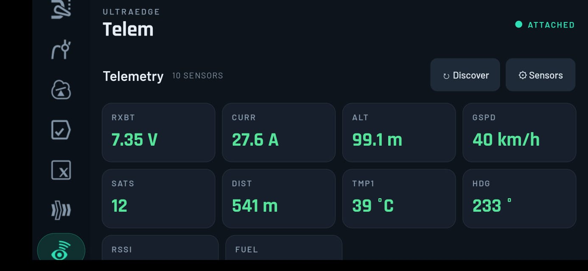
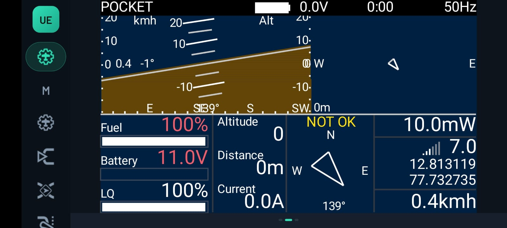

# UltraEdge for EdgeTX RC Radios

**Your Android phone as the touchscreen for your EdgeTX radio, over a USB cable.**

Plug the phone into a radio running UltraEdge firmware (EdgeTX plus a small companion module) to edit models, watch
telemetry and run Lua tools on a large screen. The radio runs the control loop. The phone edits supported settings,
which the radio validates and saves. Unplug it and the radio keeps flying.

This repository is the app's public home: the user manual, privacy policy, changelog and issue tracker. The app is
distributed only through Google Play; there are no APK downloads here, and the app source isn't published.

## Features
- Home dashboard: trims, sticks, timers, battery, RSSI, flight mode, and your radio's telemetry screens
- Model editing in EdgeTX's terms: inputs, mixes, outputs, curves, logical switches, special functions, GVars, flight
  modes and telemetry sensors, in a two-pane editor
- **Manage Models:** select, copy and delete models on the radio; back them up on the phone and restore them
- Trainer setup, and a channel Monitor with your physical sticks, pots and switches
- Radio settings, guided stick and pot calibration, sensor discovery
- Flight logs copied off the radio (beta: charts and a GPS track in the app)
- Lua tools such as ExpressLRS configuration, run inside the app

## Which version?
| | App | Firmware | Radios |
|---|---|---|---|
| **Production** | 1.3.2 ([Google Play](https://play.google.com/store/apps/details?id=com.ultraedge.companion)) | [v1.1.2.3](https://github.com/50UR4V/edgetx-ue/releases/latest), full builds | RadioMaster Pocket, Zorro, TX16S; FrSky QX7 / QX7S (not the QX7 ACCESS), all verified on hardware |
| **Beta** | 1.4.3 ([join open testing](https://play.google.com/apps/testing/com.ultraedge.companion)) | [1.1.22](https://github.com/50UR4V/edgetx-ue/releases/tag/v1.1.22), pre-release | 56 EdgeTX radios; status per radio in `SUPPORTED-RADIOS.md` on the release |

UltraEdge is made for any EdgeTX radio. Radios are marked verified as we, our testers or the community check them on
hardware. Details: [User Manual › Which version?](UserManual/README.md#which-version)

## Get it
1. Install from [Google Play](https://play.google.com/store/apps/details?id=com.ultraedge.companion) (Android 7.0 or
   newer, a phone with USB host/OTG).
2. Flash UltraEdge firmware to your radio: see [EdgeTX-UE releases](https://github.com/50UR4V/edgetx-ue/releases).
3. Plug in over USB and tap **Open UltraEdge**. Full guide: [User Manual](UserManual/README.md).

## Useful downloads (SD card and Lua scripts)
Copy these to the radio's SD card with a card reader, or from the app under **System › SD Card**.

| What | Where | Status with UltraEdge |
|---|---|---|
| EdgeTX sound pack (voice prompts) | [EdgeTX/edgetx-sdcard-sounds releases](https://github.com/EdgeTX/edgetx-sdcard-sounds/releases) | ✅ Verified |
| iNav telemetry widget (Lua) | [iNavFlight/OpenTX-Telemetry-Widget](https://github.com/iNavFlight/OpenTX-Telemetry-Widget) | ✅ Verified |
| ExpressLRS configuration (Lua) | [ExpressLRS Lua how-to](https://www.expresslrs.org/quick-start/transmitters/lua-howto/) | ✅ Verified |
| Betaflight TX Lua scripts | [betaflight/betaflight-tx-lua-scripts](https://github.com/betaflight/betaflight-tx-lua-scripts) | ⚠️ Unverified |
| Yaapu FrSky telemetry (Lua) | [yaapu/FrskyTelemetryScript](https://github.com/yaapu/FrskyTelemetryScript) | Runs on the radio; not yet in the app (compiled `.luac` packages) |

## Screenshots
<table>
  <tr>
    <td width="50%"> Home dashboard: RSSI, battery, timer.</td>
    <td width="50%"> Phone mounted on a Pocket, running a Lua telemetry screen.</td>
  </tr>
  <tr>
    <td width="50%"> Live telemetry: discover and view your sensors.</td>
    <td width="50%"> Your radio's telemetry screens on the phone.</td>
  </tr>
</table>

## Related projects
- [EdgeTX-UE](https://github.com/50UR4V/edgetx-ue): the firmware (EdgeTX plus the companion overlay), GPL-2.0-only.
- [UE Protocol](https://github.com/50UR4V/ue-protocol): the radio↔phone link (specification, reference codec, tests).

**Where it's going:** the app is the first step toward a modular radio, where the gimbals, switches and case you like
stay while the screen, processing and RF can be upgraded. Nothing beyond the app and firmware is available yet.

## Privacy and licences
UltraEdge collects no personal data and talks only to your radio over USB. See the
[Privacy Policy](https://bampi2k.com/ultraedge/privacy) and [Open-Source Notices](OPEN-SOURCE-NOTICES.md).

| Part | Licence |
|---|---|
| UltraEdge app | Proprietary · embeds Lua (MIT), Barlow and Rajdhani fonts (SIL OFL 1.1), AndroidX and Kotlin (Apache-2.0) |
| [EdgeTX-UE firmware](https://github.com/50UR4V/edgetx-ue) |  GPL-2.0-only, like EdgeTX |
| [UE Protocol](https://github.com/50UR4V/ue-protocol) |  code ·  spec |

## Support
[Open an issue](https://github.com/50UR4V/UltraEdge-app/issues) for a bug or a request. Attach the diagnostics log
(**System › Diagnostics › Share log**) and, for firmware problems, your radio's Version page lines.

---
*UltraEdge is an independent community project, not affiliated with or endorsed by EdgeTX, FrSky or RadioMaster. Their
names are trademarks of their respective owners.*
