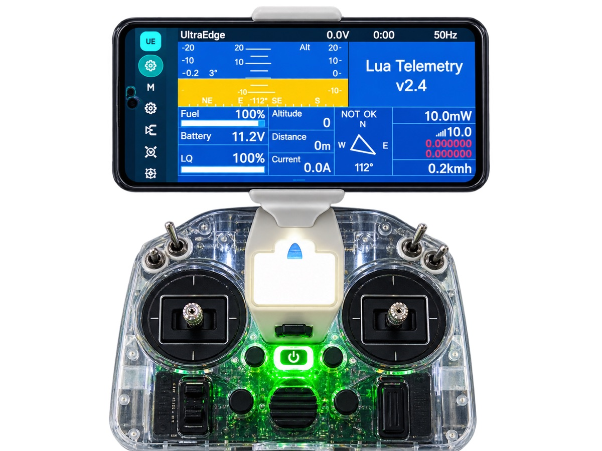

# 1. Overview

[← Contents](README.md) · [Next: Getting started →](02-getting-started.md)

## What UltraEdge is

UltraEdge has two parts that work together:

- **UltraEdge firmware.** This is EdgeTX with a small companion module added. It flies exactly like stock EdgeTX.
  The companion module stays idle until a phone is plugged in.
- **The UltraEdge app** for Android. Over a USB cable it reads the radio's models and settings, shows them on the
  phone's screen, and writes your changes back to the radio.

With UltraEdge, the phone does the work a PC with EdgeTX Companion would do, plus the radio's own small menus. It
runs at the field and stays in sync with the radio while you edit.

## The safety model

> [!IMPORTANT]
> **The radio always flies on its own.** The phone is never in the control loop. It cannot move a channel, arm a
> model, or override your sticks or failsafe. If the phone is unplugged, crashes or runs flat in flight, nothing
> about how the radio flies changes.

Every change you make in the app is saved into the model or radio settings on the radio itself. The radio then
flies that saved configuration. The app is a **configuration and display** tool. More in
[Safety & current limits](15-safety-and-limits.md).

## EdgeTX ↔ UltraEdge at a glance

| You know this in EdgeTX… | In UltraEdge |
|---|---|
| MODEL › SETUP (timers, trims, throttle, Internal/External RF) | **Model** tab: the same fields, with sub-pages for Timer 1–3, Trims, Throttle and the RF modules |
| MODEL › INPUTS / MIXES / OUTPUTS | **Inputs**, **Mixes** and **Outputs** tabs. The list is on the left and the editor on the right, with a **live response graph** |
| MODEL › CURVES | **Curves** tab, with a graph editor, presets (slopes/flat) and **mirror** |
| MODEL › LOGICAL SWITCHES / SPECIAL FUNCTIONS | **Logic** and **Funcs** tabs. The function list shows **only what your radio's firmware supports** |
| MODEL › GLOBAL VARIABLES / FLIGHT MODES | **GVars** and **Modes** tabs (FM trim modes included) |
| MODEL › TELEMETRY (Discover) | **Telem** tab: live tiles, **↻ Discover**, sensor settings |
| RADIO › SETUP / HARDWARE / TRAINER / CALIBRATION | **System › Radio Setup / Hardware / Switches / Trainer / Calibration** |
| MODEL SELECT (copy, delete, select) | **System › Manage Models**, plus a **library** of backups kept on the phone |
| SYS › TOOLS (ExpressLRS Lua) | **System › Tools**. The Lua runs **on the phone** with full-size buttons |
| Main view / telemetry screens / widgets | **Home**: swipeable screens with widgets, Lua telemetry scripts and the Instrument layout |
| CHANNEL MONITOR | **Monitor**: outputs, sticks, pots and switches together |
| Companion's log viewer on a PC | **System › Flight Logs**: logs copied automatically and viewed on the phone (charts + GPS track) |

## Why people use it

- **No menu diving.** Every setting is one or two taps away on a large touch screen. You don't page through a
  1.3-inch screen with a scroll wheel.
- **Pick by moving.** For any *Source* or *Switch* field you can just move the stick or flip the switch, and
  UltraEdge selects it.
- **See what you're doing.** Inputs and mixes show a live response graph as you change weight, expo, curve or offset,
  the same shape the radio computes.
- **Only valid choices.** Option lists come from your radio's firmware build. For example, Special Functions your
  firmware doesn't support are not offered.
- **Errors you can act on.** Long operations show what's happening and how long it has taken. Anything that fails
  offers **Try again** and **Share diagnostics**. Nothing fails silently.
- **Backups built in.** Export any model as an archive with its image, logs and scripts, keep a library on the
  phone, and restore it to the same radio or a different one.
- **Logs without a PC.** Flight logs copy across automatically and open in a built-in viewer with a GPS track.
- **Knows your radios.** Each radio is recognised by its processor's unique ID, so caches never get mixed up when you
  switch radios. You can give each one a name.

## What it is not

- It is **not a ground station or flight controller**. It doesn't send control signals.
- It doesn't replace your flight controller's configurator. Betaflight, INAV and ArduPilot setup still happens there.
- It doesn't need an internet connection or an account. Everything runs over the USB cable and stays on your phone.
