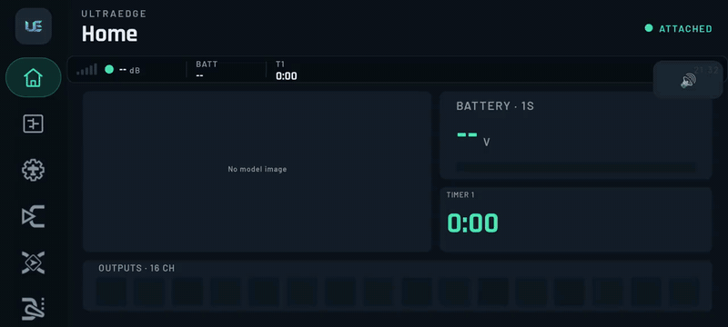
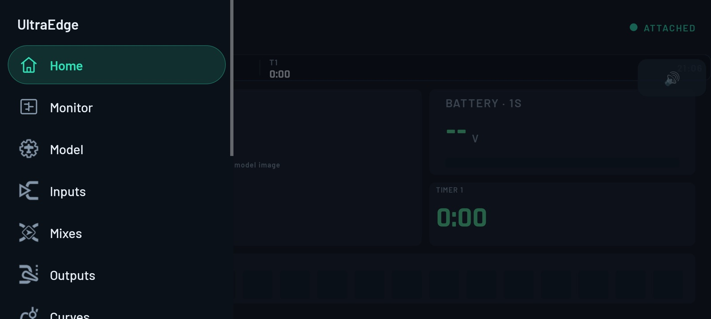

# 3. Finding your way around

[← Getting started](02-getting-started.md) · [Contents](README.md) · [Next: Home, Monitor & Telemetry →](04-home-monitor-telemetry.md)

▶ [Full-quality clip](media/clip-navigation.mp4)

## The layout

UltraEdge runs in landscape. The screen has three parts:

- **The rail** on the left: one icon per page. Tap the **UE** tile at the top to open the named menu.
- **The header**: the page title, a **‹ Back** button on sub-pages, and the link pill
  (**DETACHED / LINKING / ATTACHED**).
- **The page.**

| Page | EdgeTX equivalent | What it's for |
|---|---|---|
| **Home** | Main view + telemetry screens | Your flight screens and widgets |
| **Monitor** | Channel monitor | Live outputs, sticks, pots and switches |
| **Model** | MODEL › SETUP | Name, timers, trims, throttle, RF modules (bind, range, failsafe) |
| **Inputs** | MODEL › INPUTS | Stick/source shaping: rates, expo, curves |
| **Mixes** | MODEL › MIXES | What drives each channel |
| **Outputs** | MODEL › OUTPUTS | Servo direction, endpoints, subtrim, PPM centre |
| **Curves** | MODEL › CURVES | Custom curves |
| **Logic** | MODEL › LOGICAL SWITCHES | Conditions (for example "RxBt < 3.5 V") |
| **Funcs** | MODEL › SPECIAL FUNCTIONS | Actions (sounds, override, logging…) |
| **GVars** | MODEL › GLOBAL VARIABLES | Global variables |
| **Modes** | MODEL › FLIGHT MODES | Flight modes and their trims |
| **Telem** | MODEL › TELEMETRY | Live sensors, discovery |
| **System** | RADIO menus + Model select + Tools | Radio settings, models, logs, Lua tools, SD card, app settings |

## Two-pane editing

Every model page works the same way:

- The **left** side is the list (input lines, mixes, curves, switches…). The list header has a **＋ New …** action.
- Tap an item and its **editor opens on the right**. Change a field and the change is **saved to the radio at once**;
  there is no separate Save button.
- **Long-press** a list item for more actions: *Insert before / Insert after / Delete* for inputs and mixes,
  *Mirror / Clear* for curves, *Reset* for outputs, *Delete* for logical switches and functions.

### Field types

| Looks like | Does |
|---|---|
| `– 100% +` | A number. Tap **–/+** to step, or tap the value to type it in. |
| Chips (`Off · += · Replace`) | Pick one option. |
| `Value ▾` | Opens a list (or a picker for sources and switches). |
| `ON / OFF` | A toggle. |
| A green full-width button | An action (Bind receiver, Apply preset, Save calibration…). |

> [!TIP]
> **Pick a source or switch by moving it.** When a *Source* or *Switch* picker is open, its title reads
> "— or move a stick/switch". Wiggle the stick or flip the switch you want and UltraEdge selects it. You don't need
> to know whether it's called `SA` or `SF↑`.

## How saving works

When you change something, the app updates the model and writes it to the radio. The status line shows
**Saving…**, then **✓ Saved on radio**. Larger writes show **Sending… N%**.

If a save can't be confirmed (for example, the cable was knocked loose), a dialog explains what happened and offers:

- **Retry**: send the change again.
- **Share diagnostics**: send a log to the developers.
- **Discard change**: go back to what's on the radio.

You are never left wondering whether a change made it.

> [!NOTE]
> **EdgeTX ↔ UltraEdge:** EdgeTX saves when you leave a menu. UltraEdge saves each change as you make it. The model
> on the radio is the single source of truth. If you edit on the radio's own screen (TX16S), the app re-reads it when
> you return.

## Long operations and errors

Anything that takes more than a moment, such as reading a model, listing logs or copying a file, shows what it's
doing and how long it has taken (*"Reading the model from the radio… 3 s"*). The app retries quietly if the radio
goes silent. If it still fails, you get a card with the reason and **↻ Try again**, **⤴ Share diagnostics** and
**Dismiss**.

## Back

**Back** (the Android gesture/button or **‹ Back**) always goes **one level up**: from an editor to its list, from a
System sub-page to the System menu, then to the page you came from. At the top level, Back asks *"Press Back again to
exit"*.

## Without a radio

When the pill says **DETACHED** you can still browse your **library**, **cached model lists**, **flight logs already
on the phone**, Lua tools, SD content and app settings. Pages that need the radio say so: *"Attach the radio to edit —
changes are saved to the model on the radio."*
