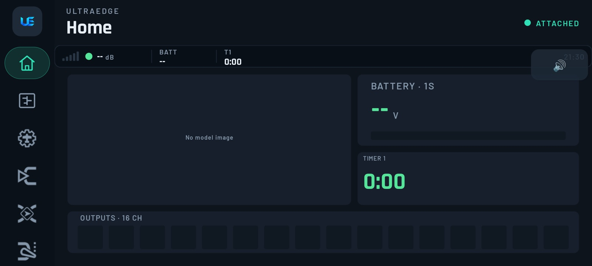
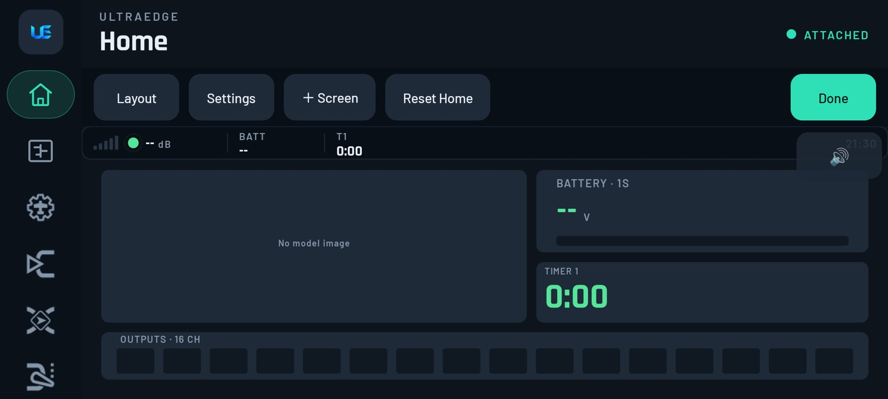
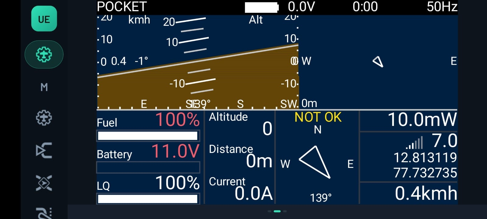
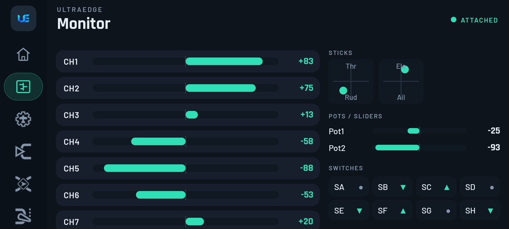
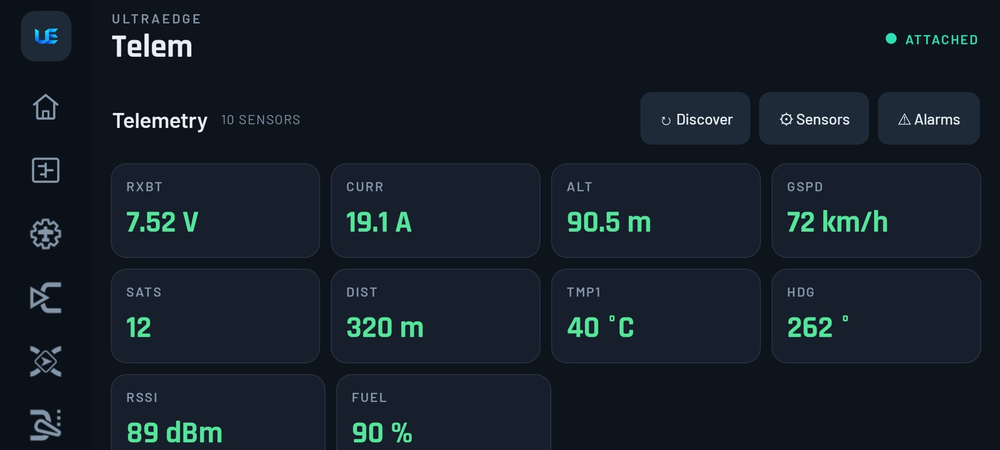
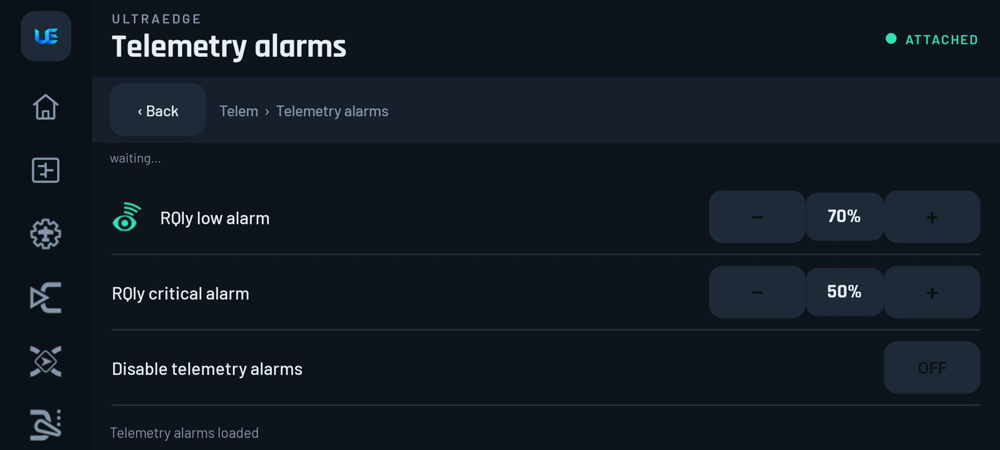

# 4. Home, Monitor & Telemetry

[← Finding your way](03-finding-your-way.md) · [Contents](README.md) · [Next: Model setup & RF →](05-model-setup.md)

## Home: your flight screens

**Home** is a set of swipeable screens. The first is the **Instrument** layout: model photo, battery, timer and an
outputs strip. Add as many more screens as you like.

- **Swipe** left and right between screens.
- The **🔊 / 🔇** button mutes all call-outs at once, for example to silence a repeating alarm on the bench. Your
  phone's own volume isn't touched.

### Editing a screen

**Long-press** a screen to edit it. The edit bar appears:

| Button | Does |
|---|---|
| **Layout** | Full screen, 2 columns, 2 rows, 2×2, 1+2, 2×3, Instrument |
| **Settings** | Top bar on/off, show trims, show sliders, show flight mode; *Set up top-bar widgets…* (three cells: battery, RSSI, a timer, flight mode or any sensor) |
| **＋ Screen** | Add a screen |
| **Reset Home / Delete** | Reset the first screen, or delete this one (at least one screen always stays) |
| **Done** | Leave edit mode |

In edit mode, tap a zone (**＋ Add widget**) to place one of these widgets:

- **Battery**
- **Value** / **Big value**: RSSI, battery or any telemetry sensor
- **Gauge**: with a min and max
- **Timer**: Timer 1, 2 or 3
- **Outputs**
- **Text**
- **Model image**: import one from the phone or use the model's photo
- **Lua script**: a telemetry/OSD script such as iNav or Yaapu. See [Lua](12-lua-tools-sd-sounds.md).

> [!TIP]
> **EdgeTX ↔ UltraEdge:** on a 128×64 radio you get one small telemetry screen. Here, any EdgeTX Lua telemetry
> screen runs **on the phone** at full size, and colour-radio-style widget layouts work on mono radios too.

## Monitor

A read-only live view of everything the radio is doing: **CH1–CH16** output bars, the **sticks** (labelled for your
stick mode), **pots/sliders** with your radio's real names, and every **switch** position.

> [!TIP]
> **Something moves the wrong way, or not at all?** Open Monitor and move the stick or switch. If the output bar
> doesn't move, the problem is in your Inputs or Mixes. If it moves but the servo goes the wrong way, reverse it in
> [Outputs](06-inputs-mixes-outputs.md#outputs). If it moves but the flight controller doesn't see it, check the
> receiver protocol and the flight controller's channel map.

## Telemetry

**Telem** shows a live tile for every sensor the model knows about.

- **↻ Discover** starts EdgeTX's sensor discovery. Sensors appear as the receiver reports them: RSSI, LQ, RxBt,
  GPS, current and more. Switch the receiver on and wait a few seconds.
- **⚙ Sensors** opens the sensor list, where you can set each sensor's label, unit and precision.
- **⚠ Alarms** sets the link alarms: a **low** and a **critical** threshold for the signal (EdgeTX's RSSI alarms),
  and **Disable telemetry alarms**. The radio names them for your link: **RQly** (link quality, %) on ExpressLRS and
  Crossfire, **RSSI** (dB) on most others. When the signal drops below a threshold, the radio warns, and so does the
  phone.

> [!TIP]
> **Starting points:** ELRS *RQly* low **70 %**, critical **50 %**. FrSky *RSSI* low **45 dB**, critical **42 dB**.
> Range-check, then raise them if the warnings come too late.

> [!TIP]
> **No sensors showing up?** The receiver must be bound and powered, and telemetry must be enabled on the link. For
> ExpressLRS, check the *Telem Ratio* in the ELRS Lua (**System › Tools**). Then press **↻ Discover**.

## Call-outs and sounds

UltraEdge plays the radio's sounds **through the phone**: the start-up welcome, number call-outs, Special-Function
tracks and warnings. Phone-side Lua scripts can also speak (`playFile`, `playNumber`, `playTone`).

If a script asks for a voice file the phone doesn't have, UltraEdge **reads it out with text-to-speech** instead, and
reminds you to import the voice pack (**System › Sounds** or **SD Card › Import pack**).

Mute everything with the 🔊 button on Home or **System › App Settings › Mute call-outs**.
