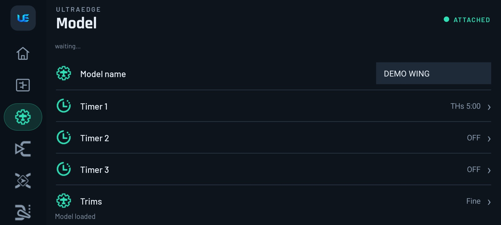
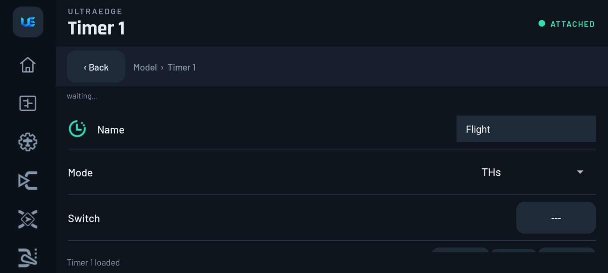
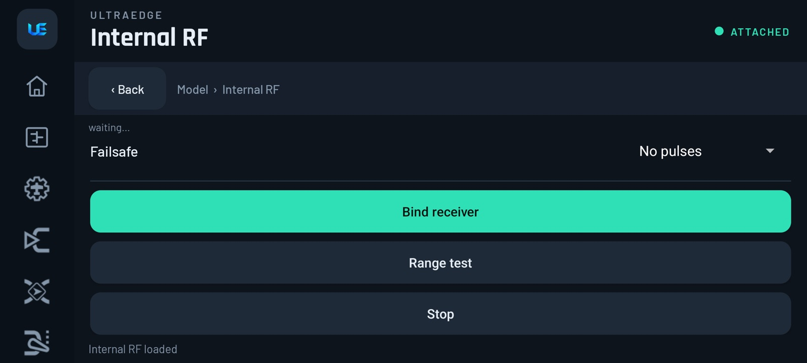
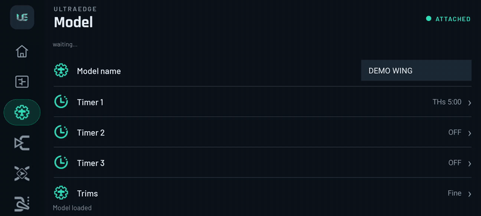
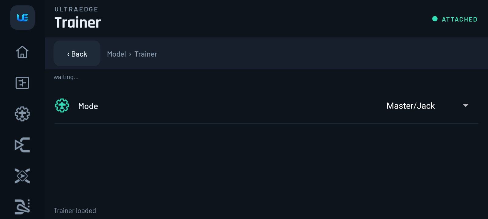

# 5. Model setup & RF

[← Home, Monitor & Telemetry](04-home-monitor-telemetry.md) · [Contents](README.md) · [Next: Inputs, Mixes & Outputs →](06-inputs-mixes-outputs.md)

The **Model** page is EdgeTX's *MODEL › SETUP*. It always shows the model that is **active on the radio**. To work on
a different model, switch to it first (see [Models & backups](10-models-and-backups.md)).

| Row | Opens | Fields |
|---|---|---|
| **Model name** | Edit in place | Up to the radio's name length |
| **Timer 1 / 2 / 3** | Timer page | Name, Mode, **Switch**, Start, Minute beep, Countdown, Persistent, Direction |
| **Trims** | Trims page | Trim increment, Display trims, Extended trims |
| **Throttle** | Throttle page | Reversed, Trim (idle-only throttle trim), **Warning** (the "throttle not idle" check at power-on) |
| **Other** | Other page | ADC jitter filter |
| **Internal RF / External RF** | Module page | Type, RX channels, First channel, **Failsafe**, plus **Bind receiver / Range test / Stop** |
| **Trainer** | Trainer page | **Mode** (master/slave and how the radios connect), plus PPM settings for Slave/Jack |

The list shows a summary of each row (for example *"THs 5:00"* for a timer), so you can check a model without
opening anything.

## Timers

| Mode | Runs when… |
|---|---|
| **OFF / ON** | Never / always |
| **Strt** | From the first time the throttle leaves idle |
| **THs** | Whenever the throttle is above idle (*"motor run time"*) |
| **TH%** | At a speed proportional to the throttle (a fuel-style countdown) |
| **THt** | From the first throttle movement, then keeps running |

**Switch** gates the timer: it only counts while the switch is on (in **Strt** mode, flipping it starts the
timer). Pick it by flipping the switch. Leave it at **---** (none) for a timer that ignores switches.

Set **Start** for a countdown (for example 5:00), **Countdown** to hear beeps or voice as it ends, **Minute beep** for
a call every minute, and **Persistent** to keep the time across power cycles (*Flight* or *Manual* reset).

> [!TIP]
> **Flight timer for a quad:** Mode **ON** + Switch = your **arm switch**. It runs exactly while you're armed. See
> [A flight timer](13-recipes.md#a-flight-timer-that-runs-with-the-throttle).

## Throttle

- **Reversed**: for radios or pilots who use a reversed throttle stick.
- **Trim**: idle-only trim. The throttle trim adjusts idle without moving full throttle (planes and helis).
- **Warning**: the "Throttle not idle" check at power-on. Leave it **on** for anything with a propeller.

> [!NOTE]
> **The throttle warning only checks the throttle *stick*.** Arming is handled by your arm switch and the flight
> controller. For a quad, an arm switch with Betaflight's *Arm* mode (see
> [arm switch recipe](13-recipes.md#arm-switch-for-betaflight--inav-aux1--ch5)) does the real protecting.

## RF modules: binding, range check and failsafe

Open **Internal RF** (the built-in module, for example ExpressLRS on a Pocket or Zorro) or **External RF** (a module in
the bay).

| Field | Meaning |
|---|---|
| **Type** | The module protocol: CRSF (ExpressLRS/Crossfire), MULTI, PPM, the FrSky protocols, or OFF. The list is the one your radio's firmware supports. |
| **RX channels** | How many channels to send (8–16) |
| **First channel** | Usually CH1 |
| **Failsafe** | *Not set · Hold · Custom · No pulses · Receiver* (see below) |
| **Bind receiver** | Puts the module in bind mode. Power the receiver in its bind mode as well. |
| **Range test** | Reduced-power range check (walk 30 m away with the model; controls must still respond) |
| **Stop** | Ends bind or range test |

▶ [Full-quality clip](media/clip-bind.mp4)

### Failsafe, explained

| Setting | What the receiver does when the link is lost |
|---|---|
| **Hold** | Keeps the last received positions |
| **Custom** | Moves each channel to a stored position |
| **No pulses** | Stops sending signal. The flight controller (Betaflight/INAV/ArduPilot) sees "no signal" and runs *its own* failsafe. |
| **Receiver** | Uses whatever failsafe is stored in the receiver itself |
| **Not set** | Nothing chosen yet. EdgeTX warns about this. |

> [!IMPORTANT]
> **ExpressLRS and Crossfire (CRSF):** the radio's failsafe setting doesn't apply to receivers that talk to a flight
> controller over a serial link. When the link drops, the receiver stops sending and the **flight controller's**
> failsafe takes over. Set that up in Betaflight/INAV (e.g. *Drop* or *GPS Rescue*). For ELRS **PWM** receivers,
> failsafe positions are set in the receiver's own settings (ELRS Lua or WebUI).
>
> **FrSky / MULTI to a plane with servos:** choose **Custom** and store throttle at idle, or **No pulses** if your
> ESC cuts on signal loss. Test it on the bench: switch the radio off and check that the motor stops.

### Binding, by system

- **ExpressLRS:** if transmitter and receiver share the same **bind phrase** (set in the ELRS Configurator), they
  connect on their own. To bind without a phrase, put the receiver in bind mode (three quick power cycles, or its
  button) and press **Bind receiver**. You can also use **[Bind]** in the ELRS Lua (**System › Tools › ExpressLRS**).
- **FrSky ACCST/ACCESS, MULTI:** set **Type** and the sub-protocol, put the receiver in bind mode, press **Bind
  receiver**, then **Stop** and power-cycle the receiver.

See the step-by-step [binding recipe](13-recipes.md#bind-or-re-bind-a-receiver).

## Trainer (buddy box)

**Model › Trainer** sets how *this model* uses a trainer link (EdgeTX's MODEL SETUP › Trainer).

| Mode | Use it when |
|---|---|
| **OFF** | No trainer |
| **Master/Jack** | You're the instructor; the student's radio plugs into your trainer jack |
| **Slave/Jack** | You're the student; your radio sends PPM out of its jack. Extra rows appear: **First channel**, **Channels**, **PPM frame**, **PPM delay**, **Polarity**. The defaults suit most radios. |
| **Master/SBUS Module**, **Master/CPPM Module** | Student signal arrives through the module bay |
| **Master/Serial** | Student signal arrives on a serial port (wireless SBUS receivers) |
| **Master/Bluetooth**, **Slave/Bluetooth** | Radios with Bluetooth trainer. Pairing is still done on the radio (TX16S). |
| **Master/Multi**, **Master/CRSF** | Wireless trainer through a Multi or CRSF module |

The list shows **only the modes your radio supports** (for example, no Bluetooth on a radio without it). Which stick
the student controls, and how much, is set radio-wide under [System › Trainer](09-radio-settings.md#trainer). Handing
over control is a **Trainer** special function. See the [trainer recipe](13-recipes.md#trainer--buddy-box).

> [!NOTE]
> **EdgeTX ↔ UltraEdge:** the module page combines EdgeTX's Internal/External RF block, and the **Bind** and
> **Range** buttons work the same way. Receiver number / model match, power and packet rate for ExpressLRS live in the
> ELRS Lua, which runs full-size on the phone (**System › Tools**).
