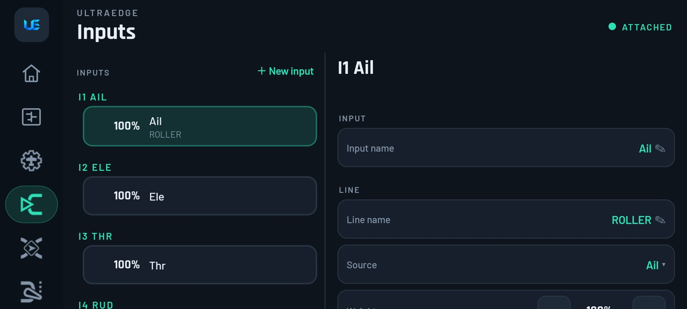
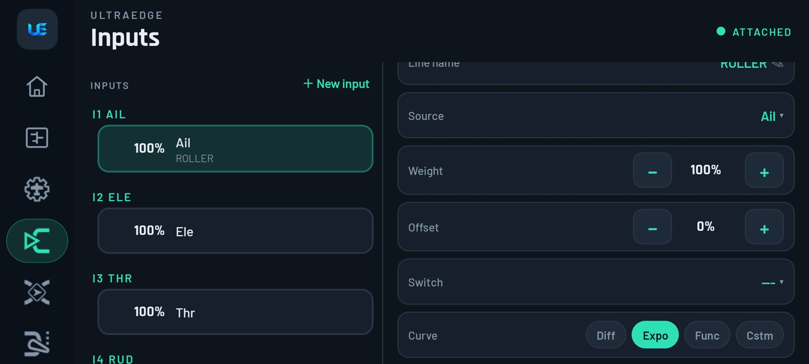
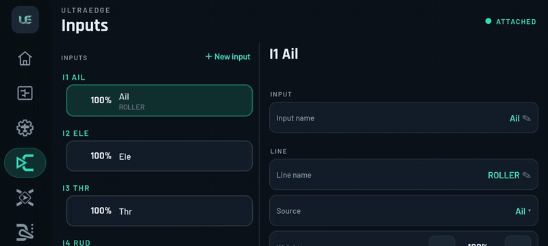
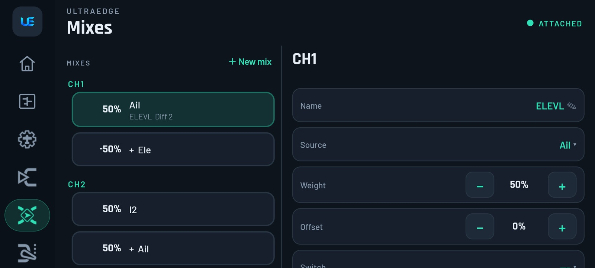
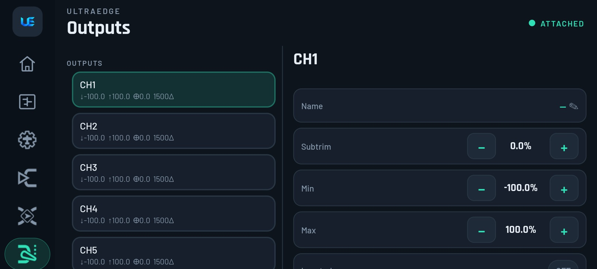

# 6. Inputs, Mixes & Outputs

[← Model setup & RF](05-model-setup.md) · [Contents](README.md) · [Next: Curves →](07-curves.md)

## The three layers, in one paragraph

EdgeTX processes every control in three steps, and UltraEdge follows the same steps:

```
 stick / switch / pot ──► INPUTS ──► MIXES ──► OUTPUTS ──► receiver
                         (how it     (which      (servo direction,
                          feels)      channel)    limits, centre)
```

- **Inputs** shape a control: rates, expo, curves, and which switch selects which rate.
- **Mixes** decide what drives each **channel**: an input, a switch, another channel, or a combination.
- **Outputs** adapt each channel to the servo or flight controller: direction, endpoints, subtrim.

> [!TIP]
> **The "Inputs vs Mixes" confusion.** Put *feel* (rates, expo) in **Inputs**, *routing and mixing* (elevons, arm
> switch on CH5, flaps) in **Mixes**, and *mechanics* (reverse, endpoints) in **Outputs**. Setting rates in a mix or
> reversing with a negative mix weight both work, but they get confusing later.

## Inputs



The list shows each input (I1 Ail, I2 Ele…) with its **lines**. Tap a line to edit it on the right.

| Field | Meaning |
|---|---|
| **Input name** | Short name (shown as I1 *Ail*) |
| **Line name** | Optional label for this line, for example *HIGH* or *LOW* for rates |
| **Source** | The stick, pot, switch or telemetry value. Tip: move the stick to pick it. |
| **Weight** | The rate: how far it can move (100% = full) |
| **Offset** | Shifts the centre |
| **Switch** | This line is used only while the switch is active |
| **Curve** | *Diff*, *Expo*, *Func* or *Cstm* (a [custom curve](07-curves.md)), with its value |
| **Side**, **Trim**, **Flight modes** | Advanced: only one side of the stick, include trim or not, which flight modes use this line |

### Live response preview

 *Beta: needs app 1.4 (Play open testing) and firmware 1.1.22. See [Which version?](README.md#which-version)*



Each line shows a graph of **stick position → output**, calculated with EdgeTX's own maths for weight, offset, expo,
diff, functions and curves. Change any value and the graph updates immediately, so you can **see** expo before you
fly it.



<sub>▶ [Full-quality clip](media/clip-expo.mp4)</sub>

> [!NOTE]
> **Multiple lines = rates.** Within one input, the radio uses the **first line whose switch is active**. Put the
> most specific switch positions first and a catch-all line (no switch) last. See
> [dual rates & expo](13-recipes.md#dual-rates--expo-on-a-switch).

**List actions:** **＋ New input**. **Long-press** a line to *Insert before*, *Insert after* or *Delete*.

## Mixes



Each channel (CH1, CH2…) lists the mix lines that drive it. The demo model shows a flying wing: CH1 is *Ail 50% +
Ele −50%*, CH2 is *Ail 50% + Ele 50%*.

| Field | Meaning |
|---|---|
| **Name** | Optional label |
| **Source** | An input (I1…), a raw stick, a switch, MAX, a channel, a GVar… Move a control to pick it. |
| **Weight** | How much of the source (−500…500%) |
| **Offset** | Added after the weight |
| **Switch** | Line only active while the switch is on |
| **Curve** | As for inputs |
| **Multiplex** | *Add* (default), *Multiply*, *Replace*. Replace overrides the lines above it while active. Not shown on a channel's first line. |
| **Flight modes**, **Trim** | Which modes use this line; include trims |
| **Warning** | Beeps 1–3 while active |
| **Delay / Slow** (up/down) | Delay a change, or slow it down (servo speed). Useful for flaps, retracts and gear doors. |

**List actions:** **＋ New mix**. **Long-press** a line to *Insert before*, *Insert after* or *Delete*.

> [!TIP]
> Common mixes, step by step:
> [elevons](13-recipes.md#elevon-flying-wing--delta-mixing) ·
> [V-tail](13-recipes.md#v-tail) ·
> [flaperons](13-recipes.md#flaperons-and-flaps) ·
> [arm switch on CH5](13-recipes.md#arm-switch-for-betaflight--inav-aux1--ch5) ·
> [throttle cut](13-recipes.md#throttle-cut--throttle-hold).

## Outputs



Each channel's list row summarises its settings: ↓ min, ↑ max, ⊕ subtrim, PPM centre, ⇄ if inverted, ∿ if it has a
curve. Tap a channel to edit:

| Field | Meaning |
|---|---|
| **Name** | Channel name (for example *ELEVL*) |
| **Subtrim** | Fine-tune the servo centre (prefer a mechanical fix for anything over about 10%) |
| **Min / Max** | Endpoints: the furthest the servo is allowed to travel. Protects linkages from binding. |
| **Inverted** | **Reverse the servo.** This is the right place to do it. |
| **Curve** | An output curve (rarely needed) |
| **PPM Center** | The servo's neutral pulse in µs (for servos that aren't centred at 1500) |
| **Subtrim mode** | Δ (subtrim shifts the whole range) or = (symmetric) |

Long-press a channel for **Reset**. The model-wide **Extended limits** toggle allows travel up to ±150%.

> [!TIP]
> **Servo moves the wrong way?** Toggle **Inverted** on that output. Don't flip the mix weight.
> **Wing flaps hitting the stops?** Reduce **Min/Max** on that output until the linkage doesn't strain at full
> deflection.
