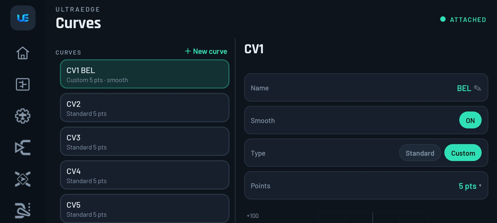
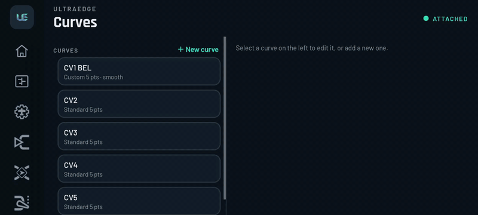

# 7. Curves

[← Inputs, Mixes & Outputs](06-inputs-mixes-outputs.md) · [Contents](README.md) · [Next: Logic, Functions, GVars & Flight modes →](08-logic-functions-gvars-modes.md)

A curve reshapes a control: a throttle curve for a heli or a gentle-centre pitch response, for example. You use a
curve from an Input or Mix line (*Curve › Cstm › CVn*) or on an Output.

| Field | Meaning |
|---|---|
| **Name** | Up to 3 characters on most radios (shown as CV1 *BEL*) |
| **Type** | **Standard** (points evenly spaced on X) or **Custom** (you set X for each point too) |
| **Points** | 2 to 17 points |
| **Smooth** | Rounds the corners between points |
| **Preset › Apply…**  | Fills the curve with a straight line at an angle, or flat |
| **Mirror (flip up/down)**  | Inverts the curve |
| Point rows | Y value per point (and X for custom curves) |

The graph redraws as you edit. A note at the bottom shows how much curve memory the model has left (*"N of MAX points
free"*). EdgeTX shares a fixed pool of points between all curves.

▶ [Full-quality clip](media/clip-curve-preset.mp4)

**List actions:** **＋ New curve**. **Long-press** a curve for **Mirror** or **Clear**.

> [!TIP]
> - **Throttle curve for a heli or a gentle motor:** a 5-point standard curve, for example 0 / 40 / 60 / 80 / 100.
> - **Softer centre than expo gives you:** a 5-point curve with a flatter middle section.
> - **Reverse a curve** you already built: **Mirror**, rather than retyping every point.

> [!NOTE]
> **EdgeTX ↔ UltraEdge:** presets and mirror follow EdgeTX's own maths, including how it rounds X positions, so a curve
> looks the same on the radio as on the phone.
