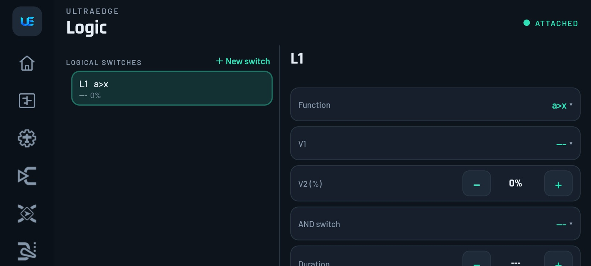
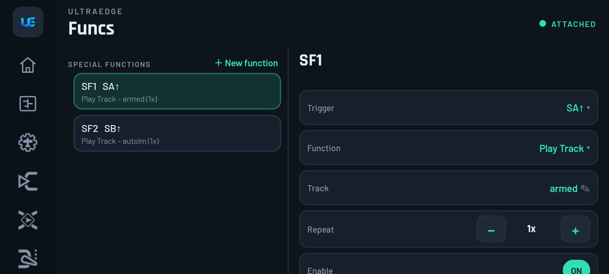
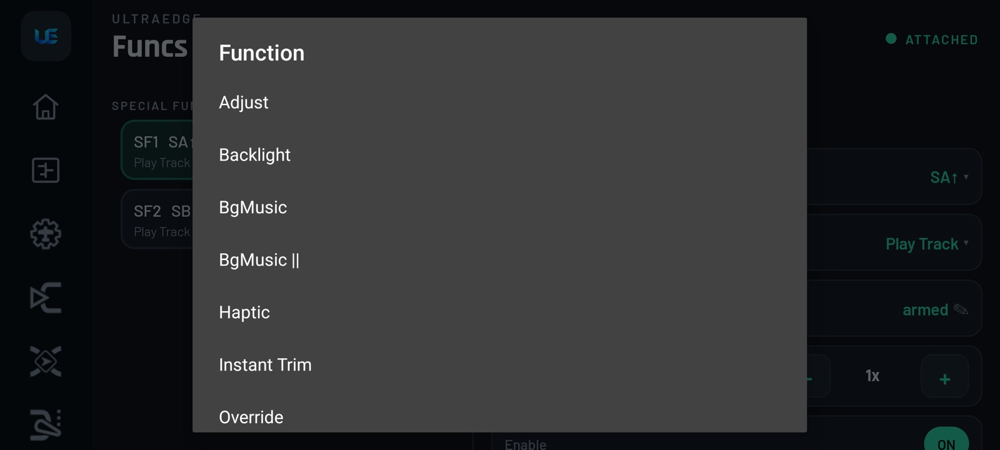
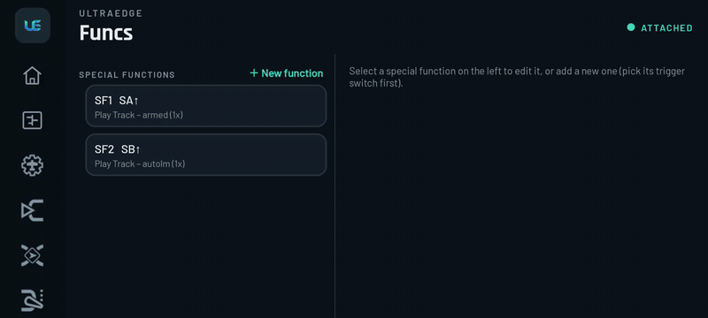
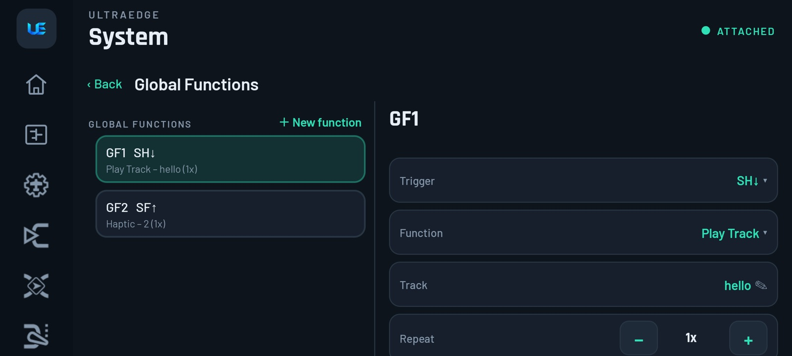
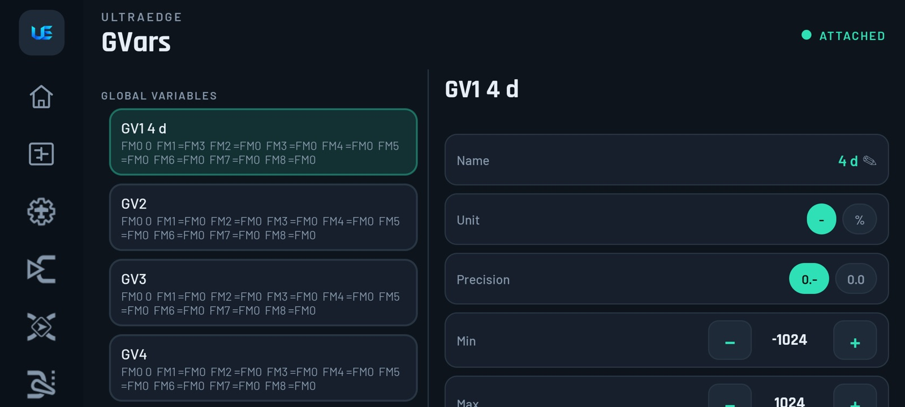
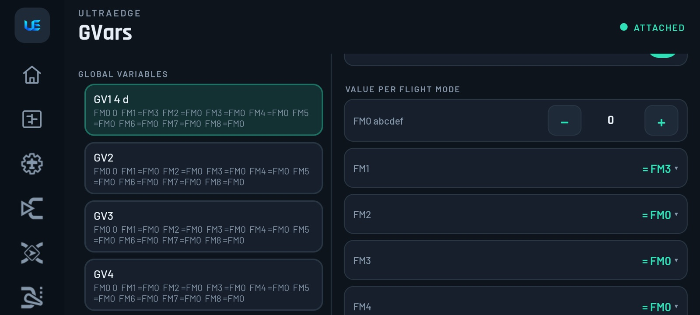
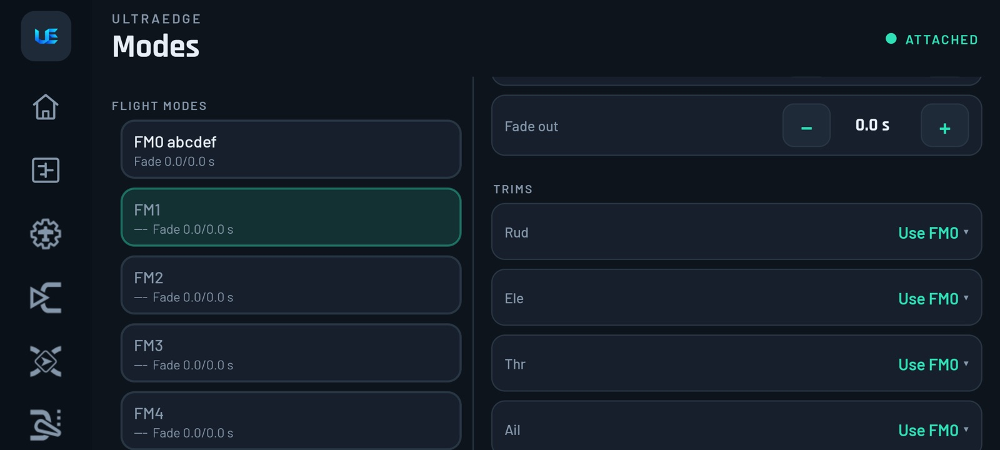

# 8. Logic, Functions, GVars & Flight modes

[← Curves](07-curves.md) · [Contents](README.md) · [Next: Radio settings →](09-radio-settings.md)

These four pages are where a model gets clever: warnings, call-outs, throttle cut, flight modes. Logical switches
**decide when**, special functions **do something**.

## Logic (logical switches)

Tap **＋ New switch**, then choose a **Function**:

| Function | True when… | Typical use |
|---|---|---|
| `a>x`, `a<x`, `a=x`, `a~x` | a source compared with a value | *RxBt < 3.5 V*, *Alt > 120 m*, *throttle > −95%* |
| `|a|>x`, `|a|<x` | absolute value compared with a value | stick deflected either way |
| `a>b`, `a<b`, `a=b` | two sources compared | |
| `Δ≥x`, `|Δ|≥x` | a source changed by at least x | detect a quick stick movement |
| `AND`, `OR`, `XOR` | two switches combined | *arm switch AND throttle low* |
| `Edge` | a switch was held for a time window | long-press a momentary switch |
| `Sticky` | latches on with V1, off with V2 | a software toggle |
| `Timer` | on/off pulses | repeating reminders |

Then fill in **V1/V2** (the picker shows the right kind: source, switch, value or time), an optional **AND switch**,
**Duration** and **Delay**.  Values are shown **in the source's own units**: volts for RxBt, metres for altitude,
mm:ss for timers. You don't need to know EdgeTX's internal raw numbers.

> [!TIP]
> **Battery warning**: `a<x · RxBt · 3.5 V`, Delay 2 s (so a voltage sag during a punch doesn't trigger it). Then
> a special function plays a sound while L1 is true. Full recipe:
> [low battery & link quality warning](13-recipes.md#low-battery--link-quality-warning).

## Funcs (special functions)

**＋ New function** first asks for the **trigger** (a switch, a logical switch, a trim, ON…). Then pick the
**Function** and its parameters:

| Function | Parameters | Use it for |
|---|---|---|
| **Override** | Channel, value | **Throttle cut** (CH3 = −100), safe servo positions |
| **Play Track / Play Value / Play Sound** | Track, source or sound; repeat | Call-outs ("armed", "battery low", read out altitude) |
| **Haptic** | Strength 0–3 | Vibrate on a warning |
| **Reset** | Timer 1–3, Flight, Telemetry, Trims | Reset a timer with a switch |
| **Set** (timer) | Timer, value | Preset a timer |
| **Adjust** (GVar) | GVar, mode (constant, source, inc/dec…) | Change a GVar in flight |
| **SD Logs** | Interval (s) | **Flight logging**. See [Flight logs](11-flight-logs.md) |
| **Trainer**, **Instant Trim**, **Volume**, **Backlight**, **Set Failsafe**, **Screenshot**, **Racing Mode**, **Set Main Screen**, **BgMusic**, **Vario**, **Lua Script**… | | As in EdgeTX |

Every function has **Repeat** (play once, every N seconds, or once, skipping the first time after power-on) and
**Enable**.

▶ [Full-quality clip](media/clip-special-functions.mp4)

> [!NOTE]
>  **EdgeTX ↔ UltraEdge: the function list comes from your radio.** EdgeTX builds differ: some leave out Lua, haptic,
> bind/range functions or RGB LEDs. UltraEdge asks the radio which functions its firmware has and offers **exactly
> those**. If a model made on another radio uses a function this radio doesn't have, it is shown as
> "(not on this radio)" rather than hidden.

## Global functions

 *Beta: needs app 1.4 (Play open testing) and firmware 1.1.18. See [Which version?](README.md#which-version)*

**System › Global Functions** holds special functions that belong to the **radio**, not to one model. They run for
every model that has **Model › Other › Use global functions** on. Typical uses: a volume knob, a "say the battery
voltage" button, a screenshot switch, or the same warning sound on all your models.

The editor is the same as **Funcs**: **＋ New function** (pick the trigger first), then Function and its parameters.
Model-only functions (**Override**, **Adjust GVar**) aren't offered, because EdgeTX doesn't allow them as global
functions.

> [!NOTE]
> **EdgeTX ↔ UltraEdge:** this is EdgeTX's *RADIO › GLOBAL FUNCTIONS*. Each change is saved on the radio straight away
> and the list is read back. If a model shouldn't run them (a glider that uses SH for something else, say), turn
> **Use global functions** off for that model.

## GVars (global variables)

Each row shows a GVar's value in every flight mode (FM0…FM8; `=FM0` means "same as FM0"). Tap one to set its
**Name**, **Unit** (– or %), **Precision**, **Min**, **Max** and whether the radio shows a **Popup** when it changes.

 Under **Value per flight mode**, set the value for each mode. FM0 always has its own value. For FM1–FM8, choose
**Own value** and type it in, or **= FMn** to share another mode's value, just like EdgeTX.

Use a GVar wherever a weight or offset is accepted, so that one number controls several mixes. A typical example is a
single "rate" GVar used by both ailerons.

> [!NOTE]
> **EdgeTX ↔ UltraEdge:** GVar values can change **in flight** (an *Adjust* special function), so the radio always
> holds the latest. UltraEdge writes your change straight into the radio and then re-reads the model, so it never
> overwrites a value you changed in flight with an old copy.

> [!TIP]
> **One knob for both ailerons' rates:** make GV1 "Rate" = 70% in FM0 and 100% in FM1 *Sport*, then use **GV1** as
> the Weight of both aileron mixes. Changing modes changes both at once.

## Modes (flight modes)

| Field | Meaning |
|---|---|
| **Name** | Up to 10 characters on colour radios, 6 on mono |
| **Switch** | Activates this mode (FM0 is the default, so it has no switch) |
| **Fade in / Fade out** | Smooth transition between modes, in seconds |
| **Trims** (per stick) | **Own trim** (this mode keeps its own), **Use FMn** (share another mode's trim), **FMn + own** (offset on top of another mode's), **3-position**, or **Off** |

The trim *values* are set as usual with the trim buttons on the radio. The app shows them read-only.

> [!TIP]
> **Launch/landing mode for a glider or plane:** FM1 *Launch* on a switch with **Own trim** on elevator. Mixes and
> inputs can then be limited to FM1 using their **Flight modes** field.
