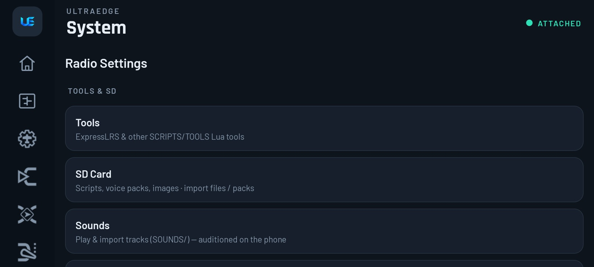
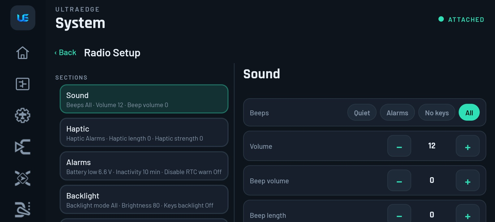
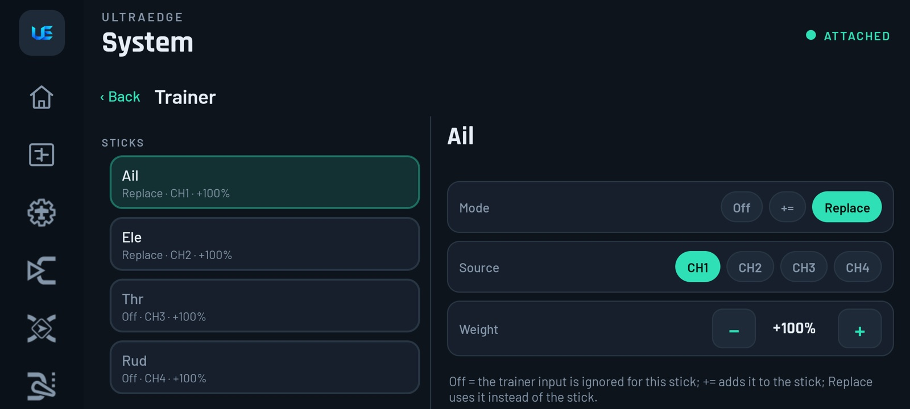
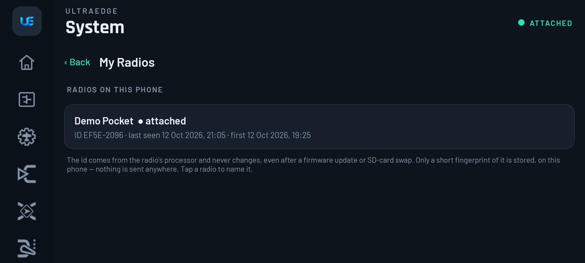

# 9. System

[← Logic, Functions, GVars & Flight modes](08-logic-functions-gvars-modes.md) · [Contents](README.md) · [Next: Models & backups →](10-models-and-backups.md)

**System** holds everything that isn't part of one model.
It fits on one screen, in three groups. Each card shows a live
one-line status, so the screen is also a quick check of the radio, the phone and the app.

| **Radio** (as in EdgeTX) | **Models and files** | **App** (this phone only) |
|---|---|---|
| Radio Setup | [Manage Models](10-models-and-backups.md) | Call-outs and phone |
| Global Functions | [Flight Logs](11-flight-logs.md) | My Radios |
| Trainer | [Tools](12-lua-tools-sd-sounds.md) | Lua screens |
| Hardware (with Switches and Calibration) | [Phone storage](12-lua-tools-sd-sounds.md#phone-storage) | Diagnostics |
| About radio | | About and licences |

Radio cards are dimmed until the radio is attached.

## Radio Setup

EdgeTX's *RADIO › SETUP*, in two panes: pick a section on the left; its fields appear on the right.

| Section | Fields |
|---|---|
| **Sound** | Beeps mode, volume, beep volume and length, speaker pitch, wav volume |
| **Haptic** | Haptic mode, strength, length |
| **Alarms** | Battery low voltage, inactivity timer, RTC warnings |
| **Backlight** | Mode, brightness, keys backlight |
| **Date, time & GPS** | Timezone, adjust clock from GPS, GPS format, units |
| **Startup & language** | Silent boot, country |
| **Sticks & ports** | **Stick mode** (Mode 1–4), **USB mode** (Ask / Joystick / Storage / Serial), jack mode |

> [!TIP]
> **Using the radio as a simulator joystick?** Set **USB mode** to **Ask**. When you plug into a PC you can pick
> *Joystick*; when you plug into the phone, pick *Serial*. If USB mode is set to *Joystick*, UltraEdge can't connect.
> **Companion builds:** use ENTER on the UltraEdge screen instead
> (see [USB mode on companion builds](02-getting-started.md#usb-mode-on-companion-builds)).

## Global Functions

Special functions that run for every model. See [Global functions](08-logic-functions-gvars-modes.md#global-functions).

## Trainer

For each stick (Ail, Ele, Thr, Rud): **Mode** (*Off* = ignore the student, *+=* = add the student's input to yours,
*Replace* = the student flies that stick), **Source** (which trainer channel) and **Weight**. Under *Trainer input*,
**Calibrate trainer input** centres the student's sticks.

The *trainer mode* (master/slave, jack/Bluetooth/Multi) is a per-model setting:
[Model › Trainer](05-model-setup.md#trainer-buddy-box). You hand control over with a **Trainer** special function on
a momentary switch. See the [trainer recipe](13-recipes.md#trainer--buddy-box).

## Hardware

LCD contrast (black-and-white radios), Bluetooth mode, the warning switches (alarm, memory, RSSI-off) and FAI mode.
It also holds Switches and Calibration, as in EdgeTX.

### Switches

Give each physical switch a name (up to 3 characters), for example **ARM** for SA. The name then appears in pickers
and on the radio instead of "SA".

### Calibration

Guided stick, pot and slider calibration, driven from the phone:

1. **Step 1 · Center:** leave the sticks centred and the pots in the middle, then tap **Set centre**.
2. **Step 2 · Move to extremes:** move every stick, pot and slider through its full range, then tap
   **Save calibration**.

**Cancel**, or leaving part-way, restores the previous calibration.

> [!IMPORTANT]
> On **companion builds** (black-and-white radios such as Pocket, Zorro, QX7) this is **the** place to calibrate; the
> radio's own calibration menu isn't there. Recalibrate after flashing new firmware or replacing a gimbal.

## About radio

The radio's own Version page: **FW**, **Version** (`UE …`), **Git**, **Built** and the EdgeTX base. Include these
when you report a problem. Also here:

- **radio.yml:** a read-only overview of every global setting, as the radio stores it.
- **Back up radio settings:** shares the radio's `radio.yml` file. Keep it with your model backups.

## Call-outs and phone

Settings for this phone only; the radio's own sound, backlight and haptic settings are in Radio Setup.

- **Show mute button:** shows the 🔊/🔇 button on the flight screens. Turning it off also un-mutes.
- **Call-out volume:** voice and beep call-outs on the phone.
- **Voice language** and **voice pack:** the pack lives in [Phone storage › Sounds](12-lua-tools-sd-sounds.md#phone-storage).
- **Vibration strength** and **screen brightness** while UltraEdge is open (0 = follow the phone).
- **Connectivity:** UltraEdge uses no internet. Everything runs over USB.

## My Radios

*Firmware v1.2.0 (or beta 1.1.22 on other radios).*

Every radio this phone has connected to, identified by a fingerprint of its processor's **unique ID**, which never
changes, even after a firmware update or an SD-card swap. The list shows which one is **● attached**. Select a radio
to **name** it, see its last firmware, when it was first and last seen and what's kept for it on the phone, or
**Forget** it.

Each radio's model list and flight-log list are kept separately, so plugging in a different radio never shows the
previous radio's models or logs. A radio whose firmware can't identify itself (such as the v1.1.2.x full builds) shows
as **Attached radio · unidentified** and uses the shared lists. Only a short fingerprint is stored on the phone; the
processor ID itself is never stored or sent anywhere.

## Lua screens and Diagnostics

- **Lua screens:** the virtual-screen size Lua telemetry scripts draw on (small colour radio, Horus-class, large),
  and your phone's real panel metrics.
- **Diagnostics:** link status, protocol, SD content, and the app's log. **Share log** sends it to support; attach it
  to any bug report.
