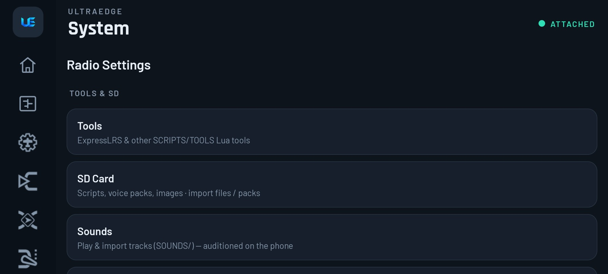
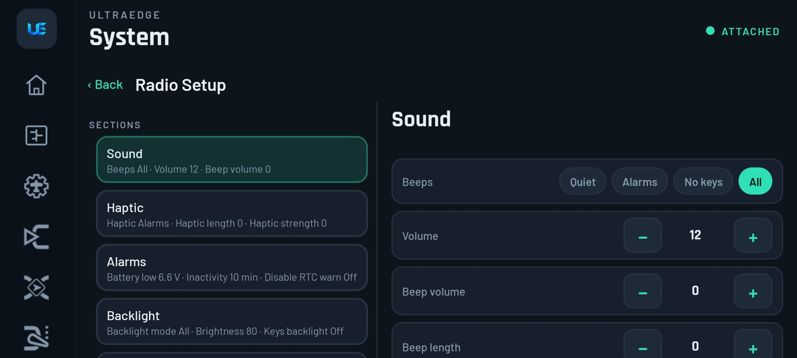
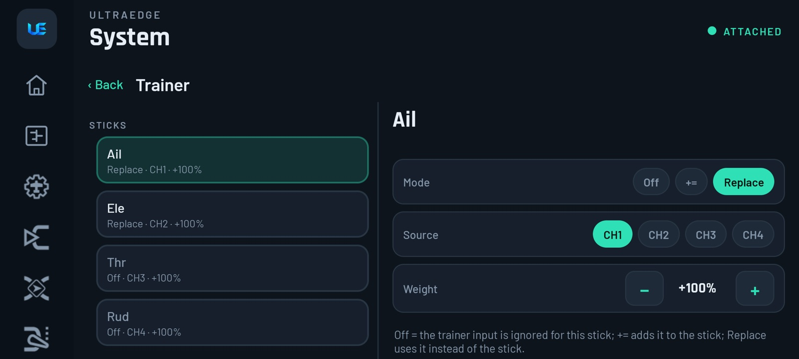
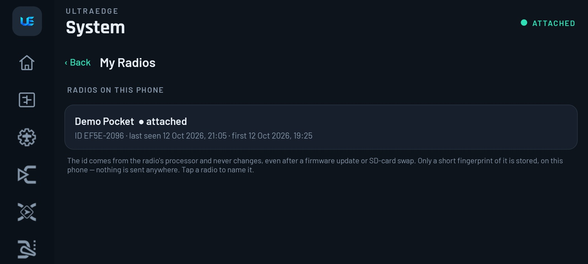
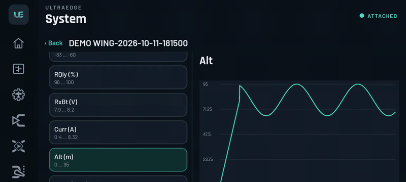
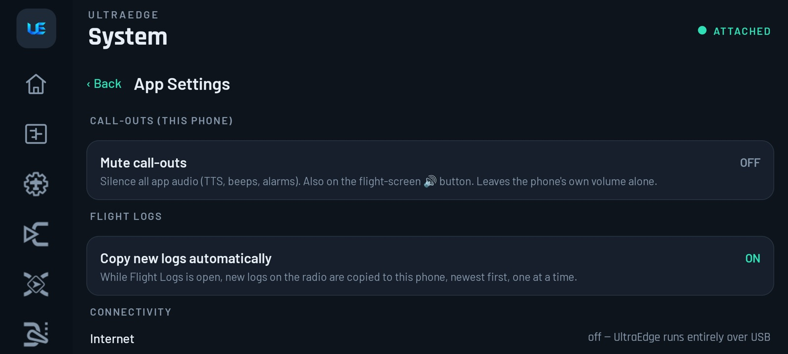

# 9. Radio settings

[← Logic, Functions, GVars & Flight modes](08-logic-functions-gvars-modes.md) · [Contents](README.md) · [Next: Models & backups →](10-models-and-backups.md)

**System** holds everything that isn't part of one model: the radio's own settings, models, logs, tools, SD content
and the app's settings.

| Section | Items |
|---|---|
| **Tools & SD** | Tools (ExpressLRS and other Lua tools) · SD Card · Sounds · Flight Logs |
| **Radio setup** | Radio Setup · Hardware · Switches · Calibration · Trainer · Global Functions · All settings (radio.yml) |
| **Model** | Manage Models · Model (from file) · Backup |
| **Display & diagnostics** | Display · Diagnostics |
| **UltraEdge app** | App Settings · My Radios · About & Licenses |

Pages that need the radio are dimmed when it isn't attached ("needs radio link").

## Radio Setup

EdgeTX's *RADIO › SETUP*.  The beta shows it in two panes, grouped into sections; production shows the same settings as a list. Pick a section on the left; its fields appear on the right.

| Section | Fields |
|---|---|
| **Sound** | Beeps mode, volume, beep volume and length, speaker pitch, wav volume |
| **Haptic** | Haptic mode, strength, length |
| **Alarms** | Battery low voltage, inactivity timer, RTC warnings |
| **Backlight** | Mode, brightness, keys backlight |
| **Date, time & GPS** | Timezone, adjust clock from GPS, GPS format, units |
| **Startup & language** | Silent boot, country |
| **Sticks & ports** | **Stick mode** (Mode 1–4), **USB mode** (Ask / Joystick / Storage / Serial), jack mode |

> [!TIP]
> **Using the radio as a simulator joystick?** Set **USB mode** to **Ask**. When you plug into a PC you can pick
> *Joystick*; when you plug into the phone, pick *Serial*. If USB mode is set to *Joystick*, UltraEdge can't connect.

**Hardware** covers LCD contrast (mono radios), Bluetooth mode, and the warning switches (alarm, memory, RSSI-off).

**All settings (radio.yml)** is a read-only overview of every global setting, including the board and EdgeTX
version. It's useful when someone on a forum asks "what's your setup?".

## Switches

Give each physical switch a name (up to 3 characters), for example **ARM** for SA or **FM** for SC. The name then
appears everywhere in the app and on the radio instead of "SA".

## Trainer

For each stick (Ail, Ele, Thr, Rud): **Mode** (*Off* = ignore the student, *+=* = add the student's input to yours,
*Replace* = the student flies that stick), **Source** (which trainer channel) and **Weight**. Under *Trainer input*,
**Calibrate trainer input** centres the student's sticks.

The *trainer mode* (master/slave, jack/Bluetooth/Multi) is a per-model setting:
[Model › Trainer](05-model-setup.md#trainer-buddy-box). You hand control over with a **Trainer** special function on
a momentary switch. See the [trainer recipe](13-recipes.md#trainer--buddy-box).

## Calibration

Guided stick, pot and slider calibration, driven from the phone:

1. **Step 1 · Center**: leave the sticks centred and the pots in the middle, then tap **Set centre**.
2. **Step 2 · Move to extremes**: move every stick, pot and slider through its full range. The live graphic shows
   each one reaching its ends. Tap **Save calibration**.

**Cancel**, or leaving the page part-way, restores the previous calibration.

> [!IMPORTANT]
> On **companion builds** (Pocket, Zorro, QX7) this is **the** place to calibrate; the radio's own calibration menu
> isn't there. Recalibrate after flashing new firmware or replacing a gimbal.

## My Radios

 *Beta: needs app 1.4 (Play open testing) and firmware 1.1.19. See [Which version?](README.md#which-version)*

Every radio this phone has connected to, identified by a fingerprint of its processor's **unique ID**. That ID never
changes, even after a firmware update or an SD-card swap. The list shows which one is **● attached**, plus first and
last seen. **Tap a radio to name it**, for example "Pocket (field box)".

▶ [Full-quality clip](media/clip-my-radios.mp4)

Each radio's cached model list and flight-log list are kept separately. Plugging in a different radio never shows the
previous radio's models or logs. Only a short fingerprint is stored on the phone; the processor ID itself is never
stored or sent anywhere.

## App Settings

Settings for the **phone side** of UltraEdge:

- **Mute call-outs.**
- **Copy new logs automatically** (see [Flight logs](11-flight-logs.md)).
- **Connectivity:** UltraEdge uses no internet. Everything runs over USB.
- **Dual settings:** backlight, volume and haptic strength, each targeted at the **Radio**, the **Phone** or **Both**.
  For example, turn call-out volume up on the phone without changing the radio's beeper.

## Display & Diagnostics

- **Display:** choose the virtual-screen size Lua scripts draw on (small colour radio, Horus-class, large), and see
  your phone's real panel metrics.
- **Diagnostics:** link status, protocol, SD content, and the app's log. **Export UltraEdge log** shares it with
  support. Attach it to any bug report.
