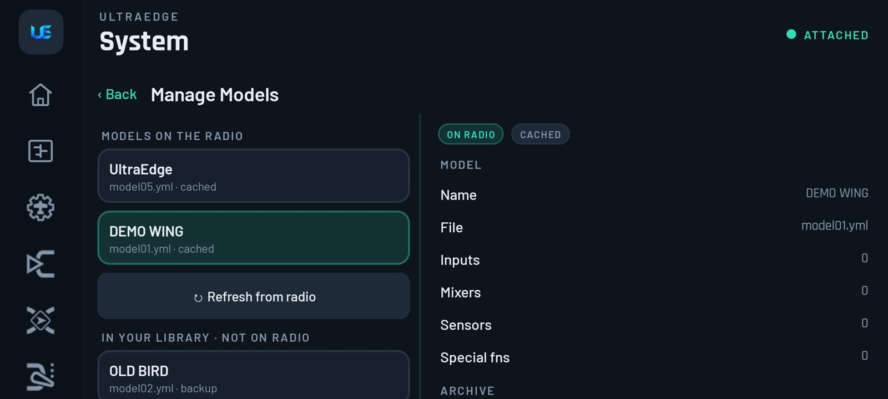

# 10. Models & backups

[← Radio settings](09-radio-settings.md) · [Contents](README.md) · [Next: Flight logs →](11-flight-logs.md)

## Manage Models

**System › Manage Models** is EdgeTX's *Model Select* with backups added.

The list has two sections:

- **Models on the radio**: everything in the radio's `/MODELS`. Chips mark **ACTIVE** (the one the radio is flying)
  and **CACHED** (shown from the phone's last copy while the radio's list is being read). **↻ Refresh from radio**
  re-reads the list.
- **In your library · not on radio**: backups kept on the phone.

Tap a model to see its name, file and how many inputs, mixes, sensors and special functions it has. Then:

| Action | What it does |
|---|---|
| **✓ Set as active (switch)** | Makes this the model the radio flies. The app then re-reads it. |
| **⧉ Duplicate on radio** | Makes a copy on the radio, the quickest way to start a new model from a similar one |
| **🗑 Delete from radio** | Asks to confirm first. You can't delete the active model. |
| **⤓ Export archive (.zip)** | Saves the model plus its image, logs and scripts as one file you can share or keep |

 **＋ New model** (under the list) asks the radio to create a **blank model** with its default setup (inputs and mixes
for the four sticks, the radio's default RF module, a name like *MODEL07*) and switch to it. Your current model is saved
first. Like switching models, it's refused while the throttle isn't at idle.

For a model in your **library**:

| Action | What it does |
|---|---|
| **⤒ Restore to radio** | Writes it back to the radio, as a new model if the slot is taken |
| **⤓ Export backup** | Shares the `.uemodel.zip` |
| **🗑 Remove from library** | Removes it from the phone only |

After Duplicate, Delete, Switch or Restore the list refreshes by itself.

> [!TIP]
> **Starting a new model?** Duplicate a model that's close (same receiver type, same kind of aircraft), switch to
> the copy, rename it on the **Model** page, then change what's different. It's faster than starting blank, and the
> RF and failsafe settings come along. For a clean start, use **＋ New model**.

## Backups

- **System › Backup** saves the active model **and** the radio's settings off the radio.
- **Export archive** (in Manage Models) packs one model with everything it uses: `MODELS/…yml`, its image from
  `IMAGES/`, its logs and any scripts it references, plus a manifest. Share it through any app (Drive, email,
  messaging) or keep it.

> [!IMPORTANT]
> **Back up before you flash firmware or change SD content.** Lost models after an upgrade are one of the most
> common EdgeTX complaints. A UltraEdge archive takes seconds and restores with one tap.

## Copy a model to another radio

1. With radio A attached: **Manage Models › your model › ⤓ Export archive**. The model is also in your library.
2. Plug in radio B (UltraEdge recognises it as a different radio, see [My Radios](09-radio-settings.md#my-radios)).
3. **Manage Models › In your library › the model › ⤒ Restore to radio.**
4. On radio B: re-bind if it uses a different RF module, then **check Outputs and switch names**. Radios differ in
   switches and pots (a Pocket has fewer than a TX16S), so anything that referenced a missing switch needs a new
   one.

## Model (from file)

**System › Model (from file)** shows the active model as stored in its file: inputs, mixes, flight modes, special
functions and sensors. You can rename inputs, mixes and flight modes there. It's mainly a cross-check; the model pages
are the normal place to edit.
