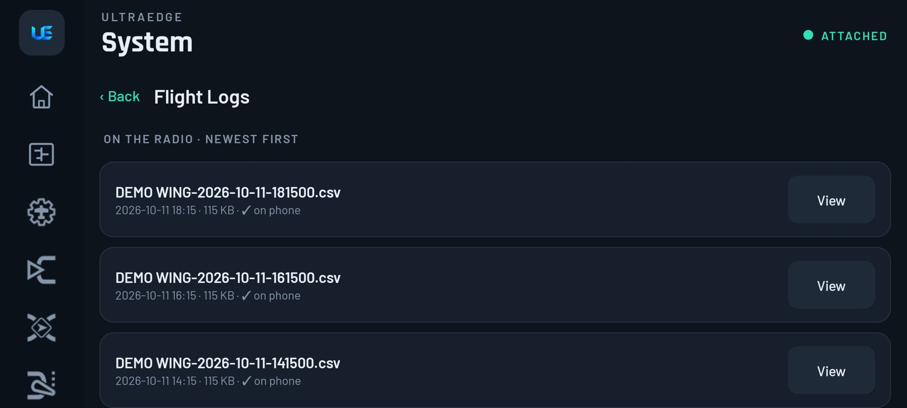
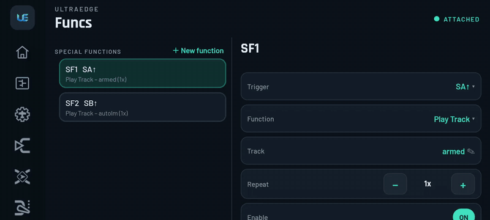
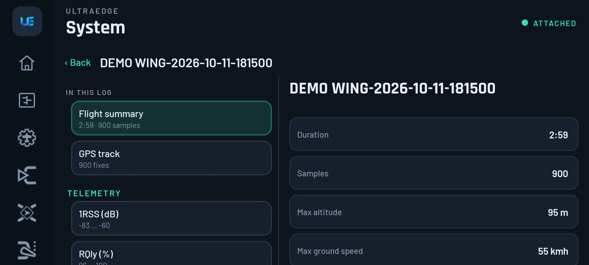
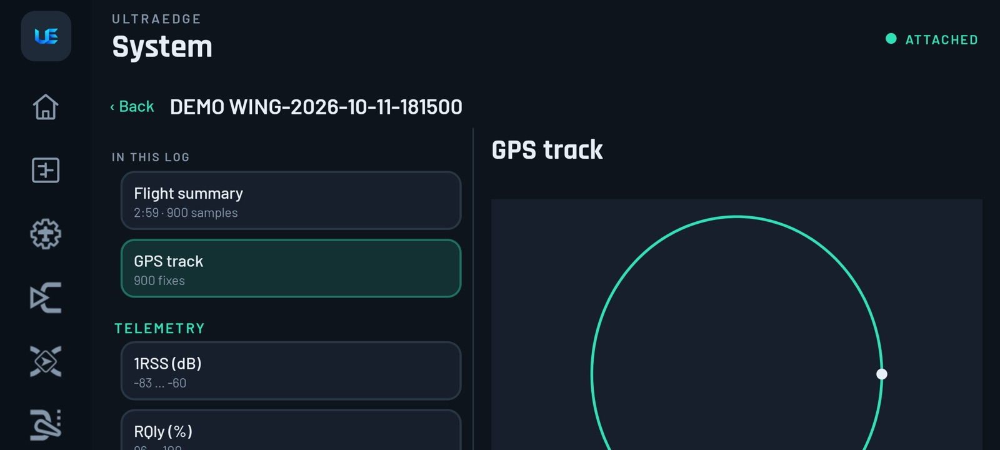
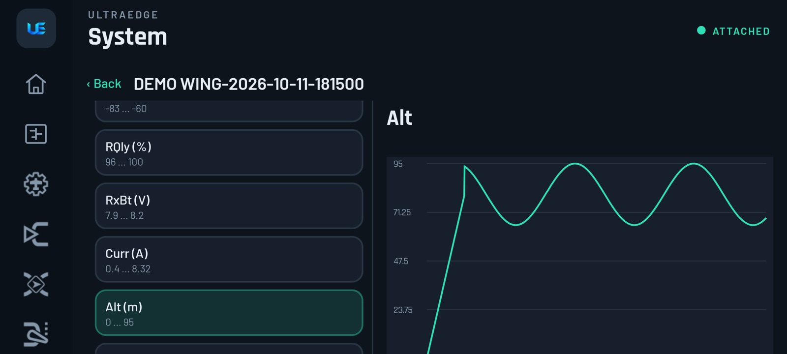

# 11. Flight logs

[← Models & backups](10-models-and-backups.md) · [Contents](README.md) · [Next: Lua, Tools, SD card & Sounds →](12-lua-tools-sd-sounds.md)

EdgeTX writes a `.csv` log to the SD card while an **SD Logs** special function is active. UltraEdge copies those
logs to the phone and shows them without a PC.

## 1. Turn logging on (once per model)

**Funcs › ＋ New function** → trigger **ON** (always) or your **arm switch** → function **SD Logs** → **Interval**
0.1–1.0 s. Lower intervals give finer detail and bigger files.

> [!TIP]
> Trigger logging from the **arm switch** so you get one log per flight instead of one long log of the model sitting
> on the bench.

## 2. Find and copy logs

**System › Flight Logs**:

-  **On the radio · newest first**: the radio's logs, 8 at a time, newest flight at the top. **Load 8 more** fetches
  older ones; **↻ Check for new logs** looks again.
-  With **Copy new logs automatically** on (App Settings), new logs copy to the phone one at a time while the page is
  open. Each row shows *queued*, *copying…* with progress, or *✓ on phone*.
- **Saved on this phone**: logs already copied. **View**, **Share** or **Delete** each one.

> [!NOTE]
> **Copying never blocks the rest of the app.** If you open something that needs the link, such as a model in
> Manage Models, the copy **pauses** and tells you so. It resumes when you come back to Flight Logs.

## 3. View a log

 *Beta: needs app 1.4 (Play open testing) and firmware 1.1.19. See [Which version?](README.md#which-version)*

▶ [Full-quality clip](media/clip-flight-logs.mp4)

| View | Shows |
|---|---|
| **Flight summary** | Duration, samples, max altitude, max ground speed, max distance, max current, lowest RX/TX battery, link quality and RSSI |
| **GPS track** | The flight path drawn to scale, north up, with the first fix marked |
| **Any column** (Alt, RxBt, Curr, RQly, sticks, switches, channels…) | A chart with **minimum / average / maximum** |

Everything is worked out on the phone. No upload and no account.

> [!TIP]
> **Lost a model?** Open the last log, go to **GPS track** and look at where the track ends. The end of the track is
> your best search point. To do this, the log must include GPS (enable GPS telemetry on the flight controller and
> [discover the sensors](04-home-monitor-telemetry.md#telemetry)).

> [!NOTE]
> **EdgeTX ↔ UltraEdge:** stock EdgeTX needs the SD card in a PC and Companion's log viewer (or a third-party tool).
> UltraEdge pages logs newest-first, so a card with hundreds of logs stays fast. Smarter organisation (per radio, per
> model, per session) and cloud backup are planned.
