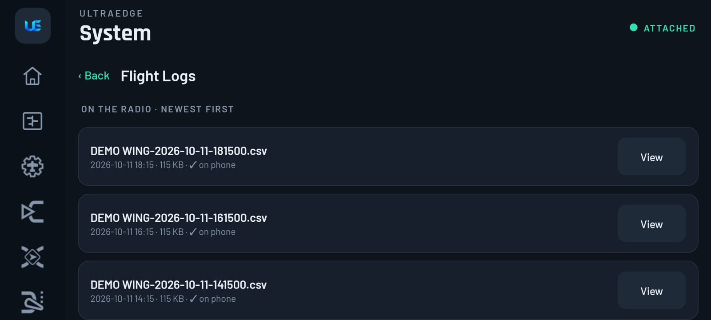
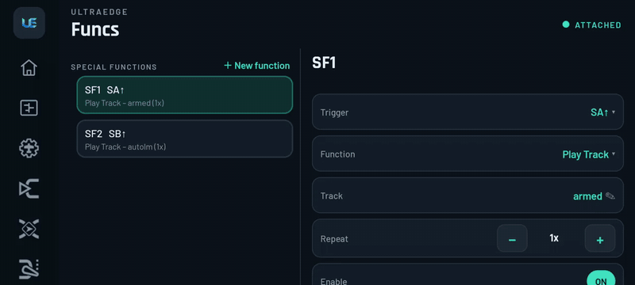
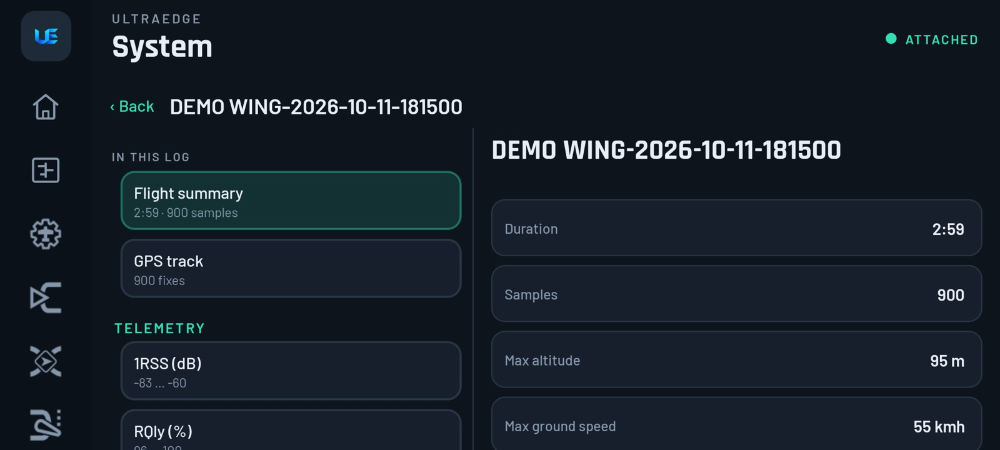
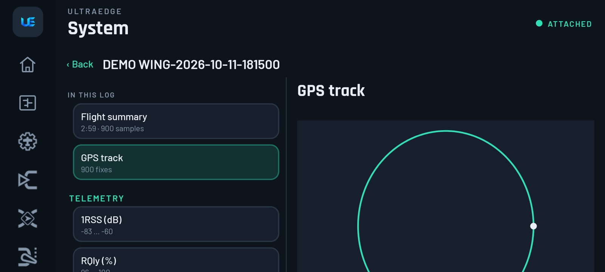
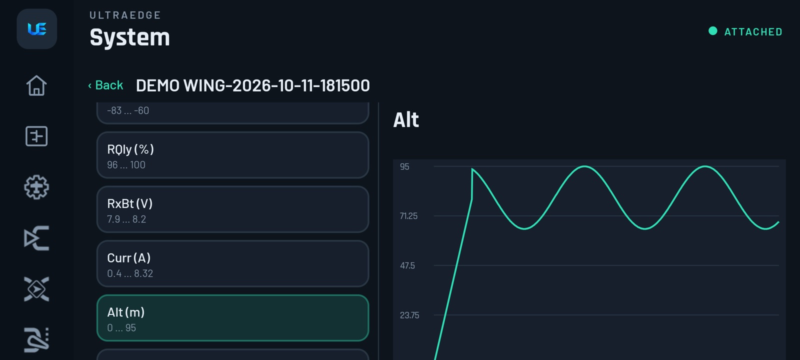

# 11. Flight logs

[← Models & backups](10-models-and-backups.md) · [Contents](README.md) · [Next: Lua, Tools and Phone storage →](12-lua-tools-sd-sounds.md)

EdgeTX writes a `.csv` log to the SD card while an **SD Logs** special function is active. UltraEdge copies those
logs to the phone and shows them without a PC.

## 1. Turn logging on (once per model)

**Funcs › ＋ New function** → trigger **ON** (always) or your **arm switch** → function **SD Logs** → **Interval**
0.1–1.0 s. Lower intervals give finer detail and bigger files.

> [!TIP]
> Trigger logging from the **arm switch** so you get one log per flight instead of one long log of the model sitting
> on the bench.

## 2. Find and copy logs

**System › Flight Logs**:

- **On the radio · newest first**: the radio's logs, 8 at a time, newest flight at the top. **Load 8 more** fetches
  older ones; **↻ Check for new logs** looks again.
- With **Copy new logs automatically** on (at the bottom of the Flight Logs page), new logs copy to the phone one at a time while the page is
  open. Each row shows *queued*, *copying…* with progress, or *✓ on phone*.
- **Saved on this phone**: logs already copied. **View**, **Share** or **Delete** each one.

> [!NOTE]
> **Copying never blocks the rest of the app.** If you open something that needs the link, such as a model in
> Manage Models, the copy **pauses** and tells you so. It resumes when you come back to Flight Logs.

## 3. View a log

▶ [Full-quality clip](media/clip-flight-logs.mp4)

| View | Shows |
|---|---|
| **Flight summary** | Duration, samples, max altitude, max ground speed, max distance, max current, lowest RX/TX battery, link quality and RSSI |
| **GPS track** | The flight path drawn to scale, north up, with the first fix marked |
| **Any column** (Alt, RxBt, Curr, RQly, sticks, switches, channels…) | A chart with **minimum / average / maximum** |

Everything is worked out on the phone. No upload and no account.

> [!TIP]
> **Lost a model?** Open the last log, go to **GPS track** and look at where the track ends. The end of the track is
> your best search point. To do this, the log must include GPS (enable GPS telemetry on the flight controller and
> [discover the sensors](04-home-monitor-telemetry.md#telemetry)).

> [!NOTE]
> **EdgeTX ↔ UltraEdge:** stock EdgeTX needs the SD card in a PC and Companion's log viewer (or a third-party tool).
> UltraEdge pages logs newest-first, so a card with hundreds of logs stays fast. To keep logs in your own Google
> Drive, see [Cloud backup](17-cloud-backup-and-account.md).

## 4. Import a flight-controller log
*App 1.7.0 beta or newer.*

You can open a log from your **flight controller**, as well as the radio's own logs. It gets the same viewer as a
radio log. Copy the file to the phone first, for example into **Downloads**.

| Flight controller | File | Where to get it |
|---|---|---|
| **ArduPilot** | `.BIN` (DataFlash) or a Mission Planner `.log` export | FC SD card › `APM/LOGS`, or Mission Planner › DataFlash Logs › *Download DataFlash Log Via Mavlink*, or QGroundControl › Analyze Tools › Log Download |
| **iNav** | `.TXT` (blackbox) | FC SD card › `LOGS`, or iNav Configurator › Blackbox › *Save flash to file* |

1. Open **System › Flight Logs** and scroll to **FLIGHT CONTROLLER LOGS · iNav · ArduPilot**.
2. Tap **＋ Import log…** and pick the file, for example from **Downloads**. Pick one file at a time.
3. The app shows *✓ imported …* and the log appears in the list below. **View**, **Share** or **Delete** it like a
   radio log.

The **ⓘ iNav**, **ⓘ ArduPilot** and **ⓘ EdgeTX** buttons show where to find each kind of log and which values
UltraEdge reads from it. The log is read on the phone and never uploaded.

> [!NOTE]
> **"isn't an iNav blackbox, ArduPilot DataFlash or EdgeTX log":** check the file type. An ArduPilot telemetry log
> (`.tlog`) isn't supported; use the `.BIN`. A file that was cut short while copying can also fail; copy it again.
> For the GPS track and replay, the log needs GPS (ArduPilot's default `LOG_BITMASK` includes it; on iNav, turn on
> blackbox logging with a GPS fitted).

## 5. 3D replay and Recovery assist
*App 1.7.0 or newer.* For a log with GPS (radio, iNav or ArduPilot):
- **3D replay** flies the log again on satellite maps, with place names and roads, at up to 20× speed. The first time,
  the app tells you that it loads the 3D engine from Cesium and map tiles from Esri and OpenStreetMap; the log itself
  stays on the phone.
- **Recovery assist** estimates where a lost model came down from the end of its log. **Refine with wind** asks
  Open-Meteo for that day's wind (the app sends only the launch point rounded to about 1 km, and the date). **Show my
  position** adds your own position and distance, after Android asks for location; it is used on the phone only.
  **Navigate**, **Copy** and **Share** hand the search point to an app you choose.

> [!TIP]
> Screenshots of these screens show coordinates and your distance. Blur them before you post one.

