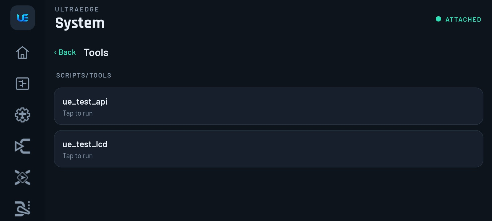
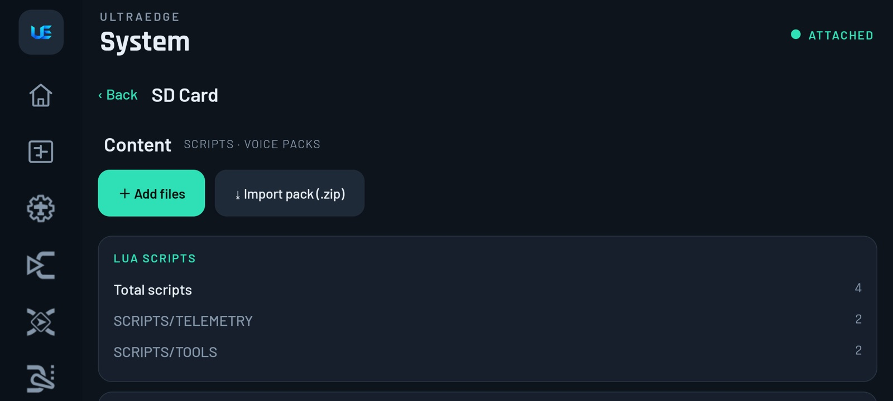

# 12. Lua, Tools, SD card & Sounds

[← Flight logs](11-flight-logs.md) · [Contents](README.md) · [Next: Recipes →](13-recipes.md)

UltraEdge has its own **Lua 5.4 engine on the phone**. EdgeTX Lua scripts (tools, telemetry screens, widgets) run on
the phone at full size, while talking to the radio and its RF module over USB.

## ExpressLRS and other tools

**System › Tools** lists the scripts in `SCRIPTS/TOOLS`. Tap one to run it. Below the script are big buttons for the
radio keys: **▲ ▼ ● Enter ☰ Menu Exit**.

With the **ExpressLRS** script you can:

- set **Packet rate**, **Telem ratio** and **TX power** (including dynamic power),
- **[Bind]**,
- turn on **WiFi** for receiver or module updates,
- set **Model Match** (with the receiver number),
- see the **Other Devices** list (receiver, backpack).

> [!TIP]
> **ELRS Lua stuck on "Loading…"?**
> 1. Make sure the module is powered: the model's **Internal/External RF › Type** must be **CRSF**.
> 2. Use the **ExpressLRS.lua that matches your ELRS version**. Get it from the ELRS Configurator or the module's
>    WebUI.
> 3. For an external module, check the baud rate in the radio's hardware settings.

No tools listed? Import `ExpressLRS.lua` (see below) and choose **Tools** as the destination.

## Telemetry screens & widgets (iNav OSD…)

> [!NOTE]
> Scripts shipped as compiled, multi-file `.luac` packages (for example **Yaapu**) don't run in the app yet. They still
> run on the radio.

Add a **Lua script** widget to a Home screen (long-press Home, tap a zone, *Lua script*). Pick an installed script or
**＋ Import script / zip…**. The script draws on a virtual radio screen; **System › Display** sets that screen's size.

## SD Card

**System › SD Card** manages the content the phone-side engine uses:

- **＋ Add files**: import a `.lua`. You're asked where it goes: **Tools**, **Telemetry** (iNav/Yaapu OSD) or
  **Functions**.
- **⤓ Import pack (.zip)**: a whole script pack or a voice pack at once.
- Cards show your Lua scripts by folder, your voice packs (`SOUNDS/<language>`) and storage use.

## Sounds

**System › Sounds** lists the tracks in `SOUNDS/`. Tap **♪ a track** to hear it on the phone, or **＋ Import audio…**
to add your own.

> [!NOTE]
> The radio itself plays only `.wav` files from its own SD card. The phone plays the call-outs it gets from the radio.
> If a voice file is missing, the phone **speaks it with text-to-speech** so you still hear the warning. Import the
> matching voice pack to get the real voice.

> [!TIP]
> **"Track list is empty" / call-outs say the wrong thing:** the voice pack must be in a folder that matches your
> language (`SOUNDS/en`, `SOUNDS/de`…). Import the pack again with **Import pack (.zip)**.
