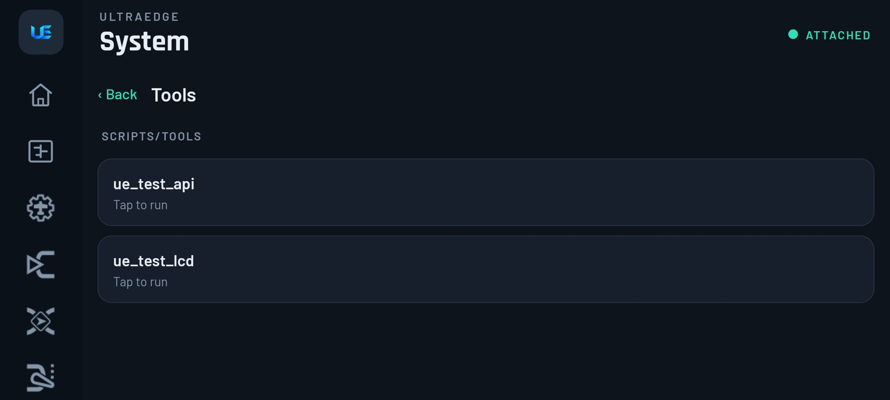
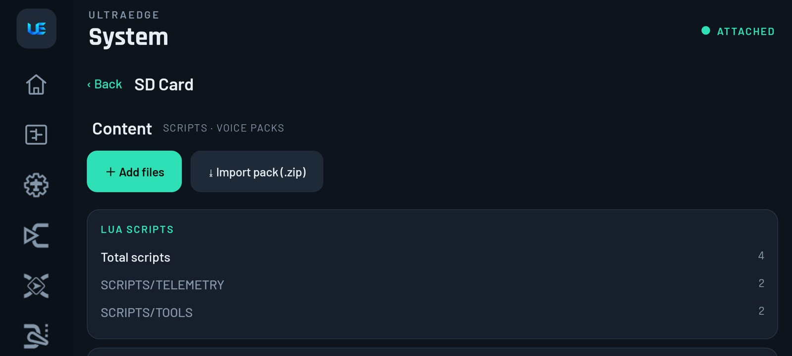

# 12. Lua, Tools and Phone storage

[← Flight logs](11-flight-logs.md) · [Contents](README.md) · [Next: Recipes →](13-recipes.md)

UltraEdge has its own **Lua 5.4 engine on the phone**. EdgeTX Lua scripts (tools, telemetry screens, widgets) run on
the phone at full size, while talking to the radio and its RF module over USB.

## ExpressLRS and other tools

**System › Tools** lists the scripts in `SCRIPTS/TOOLS`. Tap one to run it. Below the script are big buttons for the
radio keys: **▲ ▼ ● Enter ☰ Menu Exit**.

With the **ExpressLRS** script you can:

- set **Packet rate**, **Telem ratio** and **TX power** (including dynamic power),
- **[Bind]**,
- turn on **WiFi** for receiver or module updates,
- set **Model Match** (with the receiver number),
- see the **Other Devices** list (receiver, backpack).

> [!TIP]
> **ELRS Lua stuck on "Loading…"?**
> 1. Make sure the module is powered: the model's **Internal/External RF › Type** must be **CRSF**.
> 2. Use the **ExpressLRS.lua that matches your ELRS version**. Get it from the ELRS Configurator or the module's
>    WebUI.
> 3. For an external module, check the baud rate in the radio's hardware settings.

No tools listed? Import `ExpressLRS.lua` (see below) and choose **Tools** as the destination.

## Telemetry screens & widgets (iNav OSD…)

> [!NOTE]
> Scripts shipped as compiled, multi-file `.luac` packages (for example **Yaapu**) don't run in the app yet. They still
> run on the radio.

Add a **Lua script** widget to a Home screen (long-press Home, tap a zone, *Lua script*). Pick an installed script or
**＋ Import script / zip…**. The script draws on a virtual radio screen; **System › Lua screens** sets that screen's size.

## Files

**System › Files** shows the radio's SD card (firmware v1.2.1). Copy files between the radio and the phone, make
folders, and delete files and empty folders (long-press a folder).

- The app writes only to SOUNDS, SCRIPTS, WIDGETS, IMAGES, THEMES and LOGS. It never writes to MODELS or RADIO.
- It doesn't write to LOGS while the radio is recording a flight log.
- Don't change files that a running Lua script is writing.

## Phone storage

**System › Phone storage** is the phone's own UltraEdge folder: the scripts, sounds and images the app uses. These
files are on the phone, not on the radio's SD card.

- Folders on the left: Telemetry scripts, Tools, Function scripts, Mix scripts, Sounds (your voice language) and
  Images. Files on the right; tap one to **Play** (sounds), **Run** (tools), **Share** or **Delete**.
- **Import** takes any file and puts it in the right place: a `.lua` asks which script folder, a sound goes to
  Sounds (converted if needed), an image to Images, and a `.zip` voice or script pack unpacks into its folders.
- Copied flight logs and model backups have their own pages: [Flight Logs](11-flight-logs.md) and
  [Manage Models](10-models-and-backups.md).

> [!NOTE]
> The radio itself plays only `.wav` files from its own SD card. The phone plays the call-outs it gets from the radio.
> If a voice file is missing, the phone **speaks it with text-to-speech** so you still hear the warning. Import the
> matching voice pack to get the real voice.

> [!TIP]
> **"Track list is empty" / call-outs say the wrong thing:** the voice pack must be in a folder that matches your
> language (`SOUNDS/en`, `SOUNDS/de`…). Import the pack again with **Phone storage › Import**.

> **Beeps** (trims, keys, timers) play on the phone the way the radio makes them: a trim beep rises and falls with the
> trim, using the radio's **Speaker pitch** and **Beep length** (Radio Setup › Sound). *Trim centre* and the other
> spoken system sounds come from the voice pack.

## Downloads

**System › Downloads** (also **Phone storage › Get packs**) fetches two packs into Phone storage:

- the **EdgeTX voice pack** for the phone's call-outs (**Choose a voice** if there's more than one), and
- the **iNav Lua telemetry** screen and its tool.

Each comes from the project's own GitHub release, at a fixed version. The app shows the source, version, size and
licence before you tap **Download**, and checks every file against its published checksum. This is the only time
UltraEdge uses the internet; nothing about you or your radio is sent.

On a full build the radio plays sounds and runs Lua from its own SD card, so it needs the pack there too. The page
links to the same zip; unzip it to the top folder of the radio's SD card.
