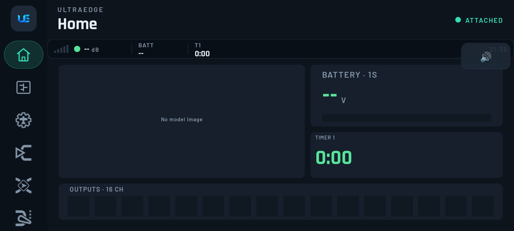

# UltraEdge User Manual

UltraEdge makes your Android phone the touchscreen for an **EdgeTX** radio, over USB or Bluetooth: models, telemetry,
binding, ExpressLRS Lua, flight logs.

> The manual uses EdgeTX names (Inputs, Mixes, Logical Switches…). Where UltraEdge differs, look for an
> **EdgeTX ↔ UltraEdge** box.

## Which version?

| | App | Firmware | Status |
|---|---|---|---|
| **Production** | 1.7.1 (Google Play) | v1.2.2 (GitHub release, Latest): companion builds on black-and-white radios, full builds on colour radios; wireless (module bay and AUX1) in one file per radio on Pocket, Zorro, TX16S and QX7 | Ready for 56 EdgeTX radios; tested in flight on Pocket, Zorro, TX16S and QX7. See [Supported radios](https://github.com/50UR4V/edgetx-ue/blob/ultraedge/SUPPORTED-RADIOS.md) |
| **Beta** | 1.7.1 (Google Play open testing), the same app as production | v1.2.2, the same files | Same as production |
| **Previous firmware** | 1.7.1 works with it, without the v1.2.2 features (wireless, trim commands, saves that keep the flight) | [v1.2.1](https://github.com/50UR4V/edgetx-ue/releases/tag/v1.2.1) | Tested on TX16S, Pocket, Zorro and QX7 (November 2026) |
| **Full-build fallback** | 1.7.1 | [v1.1.2.4](https://github.com/50UR4V/edgetx-ue/releases/tag/v1.1.2.4), full build on Pocket, Zorro, QX7 | For pilots who want to keep the radio's own menus |

## Contents

First time? The [step-by-step quick start](../QUICK-START.md) takes you from a stock EdgeTX radio to your first change, then links back here.

| # | Section | What's in it |
|---|---|---|
| 1 | [Overview](01-overview.md) | What UltraEdge is and isn't, how it compares to EdgeTX, safety model |
| 2 | [Getting started](02-getting-started.md) | Supported radios, flashing, installing, first connection, companion builds |
| 3 | [Finding your way around](03-finding-your-way.md) | Tabs, two-pane editing, saving, Back, status messages |
| 4 | [Home, Monitor & Telemetry](04-home-monitor-telemetry.md) | Flight screens & widgets, channel monitor, sensors, call-outs |
| 5 | [Model setup & RF](05-model-setup.md) | Name, timers, trims, throttle, **binding, range check, failsafe** |
| 6 | [Inputs, Mixes & Outputs](06-inputs-mixes-outputs.md) | Rates & expo, the mixer, servo direction/limits, live response preview |
| 7 | [Curves](07-curves.md) | Curve editor, presets, mirror |
| 8 | [Logic, Functions, GVars & Flight modes](08-logic-functions-gvars-modes.md) | Logical switches, special functions, global variables, flight modes & trims |
| 9 | [Radio settings](09-radio-settings.md) | Radio Setup, Hardware, Switches, Trainer, **Calibration**, My Radios |
| 10 | [Models & backups](10-models-and-backups.md) | Manage Models, duplicate/delete/select, library, archives, copy between radios |
| 11 | [Flight logs](11-flight-logs.md) | Logging, automatic copy, the built-in log viewer (charts + GPS track), importing iNav and ArduPilot logs |
| 12 | [Lua, Tools and Phone storage](12-lua-tools-sd-sounds.md) | ExpressLRS Lua, Lua widgets, the radio's SD card (System › Files), importing scripts, the UltraSim FPV simulator, downloading voice packs, UltraSim tracks and Lua scripts (iNav, StickTime, ExpressLRS) |
| 13 | [Recipes: how do I…?](13-recipes.md) | Step-by-step for the common jobs (see the finder below) |
| 14 | [Troubleshooting & FAQ](14-troubleshooting-faq.md) | "Can it do X?", fixes for the usual EdgeTX headaches |
| 15 | [Safety & current limits](15-safety-and-limits.md) | What the app never does, what still needs the radio |
| 16 | [Wireless](16-wireless.md) | The UltraEdge wireless module in the module bay or on AUX1, turning it on, `/UE/WIRELESS.TXT` |
| 17 | [Cloud backup & account](17-cloud-backup-and-account.md) | Google Drive backup, optional sign-in, install info, deleting your data |
| 18 | [Setup Assistants](18-setup-assistants.md) | Wire a flying wing, V-tail, flaperons or crow wing by watching the surfaces |

## "How do I…?" finder

| I want to… | Go to |
|---|---|
| Bind or re-bind a receiver (ELRS, FrSky, Multi) | [Recipe: bind](13-recipes.md#bind-or-re-bind-a-receiver) |
| Set up an **arm switch** for Betaflight / INAV | [Recipe: arm switch](13-recipes.md#arm-switch-for-betaflight--inav-aux1--ch5) |
| Set **failsafe** correctly (and know when it doesn't matter) | [Recipe: failsafe](13-recipes.md#failsafe) |
| Add a **throttle cut** / throttle hold | [Recipe: throttle cut](13-recipes.md#throttle-cut--throttle-hold) |
| Set up **dual rates & expo** | [Recipe: rates & expo](13-recipes.md#dual-rates--expo-on-a-switch) |
| Mix a **flying wing (elevons)**, **V-tail**, **flaperons** | [Setup Assistants](18-setup-assistants.md) · [Recipes: wings & tails](13-recipes.md#elevon-flying-wing--delta-mixing) |
| Connect **without a cable** (Bluetooth) | [Wireless](16-wireless.md) |
| Back up models and logs to **Google Drive** | [Cloud backup](17-cloud-backup-and-account.md) |
| See trims in **µs**, reset trims, trims to subtrims | [Trims](05-model-setup.md#trims) · [Trims on Home](04-home-monitor-telemetry.md#trims-on-home) |
| **Replay** a flight in 3D, find a lost model | [3D replay and Recovery assist](11-flight-logs.md#5-3d-replay-and-recovery-assist) |
| Reverse a servo, set endpoints / subtrim | [Outputs](06-inputs-mixes-outputs.md#outputs) |
| Get a **battery-voltage / RSSI warning** | [Recipe: telemetry alarms](13-recipes.md#low-battery--link-quality-warning) · [Telem › ⚠ Alarms](04-home-monitor-telemetry.md#telemetry) |
| Make a **timer** that runs with the throttle | [Recipe: throttle timer](13-recipes.md#a-flight-timer-that-runs-with-the-throttle) |
| Run the **ExpressLRS Lua** (power, packet rate, model match, WiFi) | [ExpressLRS](12-lua-tools-sd-sounds.md#expresslrs-and-other-tools) |
| Practise flying a quad or a wing with your sticks (**UltraSim**) | [UltraSim](12-lua-tools-sd-sounds.md#ultrasim-fpv-simulator) |
| Hear **voice call-outs** | [Recipe: call-outs](13-recipes.md#voice-call-outs-on-a-switch) |
| Turn on **flight logging** and see the flight on a map | [Flight logs](11-flight-logs.md) |
| Back up a model or **copy it to another radio** | [Models & backups](10-models-and-backups.md) |
| Start a **new model** from scratch | [Manage Models › ＋ New model](10-models-and-backups.md#manage-models) |
| Same function on **every model** (volume knob, voltage call-out) | [Global functions](08-logic-functions-gvars-modes.md#global-functions) |
| **Calibrate** sticks and pots | [Calibration](09-radio-settings.md#calibration) |
| Stop the model starting **armed / at full throttle / with flaps out** (switch, throttle & pot warnings) | [Pre-flight checks](05-model-setup.md#pre-flight-checks) |
| Use a **buddy box / trainer** | [Recipe: trainer](13-recipes.md#trainer--buddy-box) · [Model › Trainer](05-model-setup.md#trainer-buddy-box) |

## How these images were made

Every still and clip in this manual comes from the UltraEdge **demo** app running on an Android emulator. The demo
has a synthetic radio and a sample flying-wing model ("DEMO WING"), so names and values in the pictures are examples.
Grey dots in the clips show where a finger touched.

## The UltraEdge ecosystem

- **Website:** <https://ultraedge.app>
- **UltraEdge app** (this manual, issues, changelog): <https://github.com/50UR4V/UltraEdge-app>
- **EdgeTX-UE firmware** (download/flash for your radio): <https://github.com/50UR4V/edgetx-ue>
- **UE Protocol** (the open radio↔phone protocol): <https://github.com/50UR4V/ue-protocol>
- **Phone mounts and Baylink shells** (3D-printable): <https://github.com/50UR4V/ultraedge-mounts>

