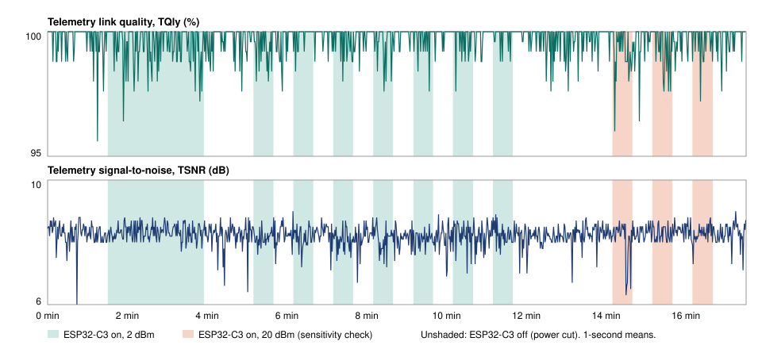

# Running a Bluetooth bridge beside ExpressLRS: a measured coexistence test

*UltraEdge technical note · test date 11 November 2026 · RadioMaster TX16S, ExpressLRS 2.4 GHz*

## Summary
UltraEdge's wireless link puts a small ESP32-C3 board on the radio's AUX port. It bridges the radio to the phone app
over Bluetooth Low Energy (BLE), on the same 2.4 GHz band as the ExpressLRS RC link and a few centimetres from the RF
module. This note measures whether that bridge degrades the RC link.

**It doesn't, in the configuration UltraEdge ships.** In a paired on/off test, with the bridge carrying live traffic to
the phone at its shipped power of 2 dBm:
- telemetry link quality (TQly) changed by **−0.18 points**;
- telemetry signal-to-noise ratio (TSNR) changed by **−0.06 dB**;
- the RC uplink did not change measurably.

The pass limits were 1 point and 1 dB. A sensitivity check at 20 dBm, 100 times the shipped power, produced a small
but detectable loss (−0.41 points). That shows the test could see an effect, and at 2 dBm the effect is less than half
as large and inside the measurement noise.

The rest of this note explains why interference was plausible, how it was measured, what the result covers and what
it doesn't.

## 1. Why this needed testing
Two 2.4 GHz radios on one transmitter raise a fair question.
- **ExpressLRS 2.4 GHz** hops across the 2.4 GHz ISM band. The handset module transmits the RC uplink to the aircraft
  and also *receives* telemetry from the aircraft's receiver: link quality, signal levels and sensor data.
- **BLE** uses the same band: 40 channels of 2 MHz, hopping across 37 data channels once a phone is connected.

The uplink is not the concern. At the aircraft, the bridge's 2 dBm (about 1.6 mW), radiated from the handset, is far
below the module's own signal, which is at least 10 mW and usually more.

The concern is the **telemetry downlink**. The module's receiver has to pick up a weak signal from a receiver that
may be hundreds of metres away, while the bridge transmits from a few centimetres. A strong nearby transmitter can
desensitise a receiver even when it isn't on the same channel. If that happened, it would show as lost telemetry
packets (lower TQly) or a lower telemetry SNR (TSNR) before the RC link itself suffered. So the test targets those two
numbers.

## 2. Design choices that limit the risk
The bridge was designed with this question in mind, before any measurement:
- **Low transmit power.** The bridge ships at 2 dBm. BLE to a phone a metre or two away needs very little power. The
  power can only be changed from the board's USB console, not from the app.
- **Not in the control path.** The bridge carries data between the radio and the phone app only. The radio generates
  the RC channels and drives the RF module itself. The bridge never sits between the sticks and the module. If the
  Bluetooth link drops, the RC link carries on as before.
- **Bluetooth Low Energy only.** The release bridge firmware has Wi-Fi compiled out. Wi-Fi would mean higher duty cycle
  and wider channels.
- **An optional off switch.** The radio powers the bridge from the AUX port and can cut that power. A pilot can name
  any switch in `/UE/AUXARM.TXT` on the SD card, and the bridge is then fully unpowered while that switch is on.

## 3. Test setup
| | |
|---|---|
| Radio | RadioMaster TX16S, UltraEdge firmware 1.2.2, AUX1 set to the UltraEdge link |
| RC link | RadioMaster Nomad module, ExpressLRS 2.4 GHz, 500 Hz packet rate, **10 mW fixed** (Dynamic power off), telemetry ratio 1:2 |
| Receiver | ExpressLRS PWM receiver powered from a BEC, in the same room, not moved during the test |
| Link level | Telemetry RSSI about −80 dBm, set with the bridge off before the test |
| Bridge | ESP32-C3 on the TX16S's AUX1 port, powered from AUX1, UltraEdge BLE bridge firmware at 2 dBm |
| Phone | UltraEdge app connected over Bluetooth, live Monitor screen open, so the bridge carried continuous traffic |
| Logging | EdgeTX SD log at 10 Hz, one file for the whole test |
| Other 2.4 GHz | The logging laptop's Wi-Fi and Bluetooth off, laptop away from the radio |

**Why these settings:**
- **10 mW** is the module's lowest power, where the RC signal is weakest relative to the bridge.
- **Telemetry ratio 1:2** sends telemetry often, so TQly is measured over many packets and is steady.
- **Fixed power and a fixed receiver** keep everything constant except the bridge.

## 4. Method: a paired A/B test
Rooms are not constant. People move, other devices transmit, and the link drifts over minutes. Comparing one long "on"
run with one long "off" run would mix that drift into the result. So the bridge was switched on and off repeatedly, and
each "on" period was compared with the "off" periods either side of it.
- **Switching:** a radio switch cut the bridge's power through the AUX port, and its position in the log marks every
  change. The bridge boots and the phone reconnects within seconds of power returning.
- **Sequence:** bridge off, then on/off in 30-second steps, eight times. The first "on" period ran about 2.5 minutes.
- **Sensitivity check:** the bridge set to 20 dBm, then three more on/off pairs.
- **Analysis:**
  - The first 10 seconds of every step are dropped, to cover the boot and the reconnect.
  - For each "on" step, the mean of each metric is compared with the mean of the neighbouring "off" steps.
  - The reported value is the mean of those differences across all pairs, with an approximate 95 % interval.
  - The analysis script, `rf_log_analyze.py paired`, is part of the UltraEdge test tools.

**Pass limits, set before the test:**
- mean drop under **1 point** in link quality, on both TQly and RQly;
- mean drop under **1 dB** in SNR, on both TSNR and RSNR.

TQly and TSNR (the downlink) are the primary metrics. RSSI values are reported but not judged: they measure the wanted
signal's strength, which interference does not reduce.

## 5. Results
**Paired differences, bridge on minus bridge off (approximate 95 % interval in brackets):**

| Bridge power | Pairs | TQly (points) | TSNR (dB) | RQly (points) | RSNR (dB) |
|---|---|---|---|---|---|
| **2 dBm (shipped)** | 8 | **−0.18** (−0.3 … 0.0) | **−0.06** (−0.1 … 0.0) | +0.05 (0.0 … +0.2) | +0.02 (−0.1 … +0.1) |
| 20 dBm (sensitivity check) | 3 | −0.41 (−0.7 … −0.2) | −0.13 (−0.3 … +0.1) | +0.18 (0.0 … +0.3) | +0.06 (−0.1 … +0.2) |

**By condition (mean / 5th percentile / minimum, after the 10 s settle):**

| Condition | Samples | TQly (%) | TSNR (dB) | RQly (%) | RSNR (dB) | TRSS (dBm, mean) |
|---|---|---|---|---|---|---|
| Bridge off | 4851 | 99.74 / 96 / 88 | 8.23 / 8 / −3 | 99.49 / 98 / 94 | 9.33 / 9 / −2 | −80.2 |
| Bridge on, 2 dBm | 2747 | 99.55 / 96 / 92 | 8.23 / 8 / 0 | 99.47 / 98 / 96 | 9.55 / 9 / 2 | −80.3 |
| Bridge on, 20 dBm | 609 | 99.30 / 96 / 88 | 8.19 / 8 / 0 | 99.81 / 99 / 97 | 9.18 / 9 / 6 | −77.8 |

*Figure 1. Telemetry link quality (top) and telemetry SNR (bottom), 1-second means. Green: bridge on at 2 dBm. Orange:
bridge on at 20 dBm. Unshaded: bridge unpowered.*

## 6. Interpretation
- **At the shipped 2 dBm there is no effect that matters.** The telemetry downlink changed by a fifth of a point in
  link quality and six hundredths of a dB in SNR. Both are a small fraction of the limits, and the SNR interval includes
  zero.
- **The test was sensitive enough.** At 20 dBm the TQly loss (−0.41 points) has an interval that excludes zero, so the
  method resolves effects of a few tenths of a point. A real effect at 2 dBm larger than about 0.3 points would have
  shown.
- **Telemetry SNR did not move,** even at 20 dBm (−0.13 dB, interval including zero). The bridge did not raise the
  noise floor the module's receiver sees.
- **The RC uplink is unaffected,** as expected from the power ratio at the aircraft.

**Conclusion.** In this configuration, a BLE bridge at 2 dBm on the radio's AUX port, carrying live traffic beside an
ExpressLRS 2.4 GHz module at 10 mW, the bridge does not measurably degrade either direction of the RC link. On that
basis, UltraEdge keeps the wireless link active while the model is armed by default. The optional arm switch in
`/UE/AUXARM.TXT` remains for pilots who prefer the bridge unpowered in flight.

## 7. What this test does not cover
- **One radio, one module, one bench.** The TX16S with an external Nomad. An internal module, a different antenna
  position, or a different bridge mounting may couple differently. Tests on other radios will be added here.
- **A moderate link, not one at the edge of range.** Link quality sat near 100 %. An earlier run with the receiver two
  rooms away inside a metal box (10 November 2026) was too unstable to separate conditions, and is not used here; it
  showed no large effect either.
- **Bench, not flight.** No flight data is part of this result.
- **Only the shipped bridge.** Other Bluetooth devices, or a bridge set above 2 dBm, are not covered.

## 8. Recommendations for pilots
- **Keep the bridge at its shipped 2 dBm.**
- **Mount it on the AUX port as designed,** not taped against the RF module or its antenna.
- **Do a range check** after fitting the bridge, as after any change to the radio, with the bridge on and the phone
  connected.
- **To have the bridge off in flight,** name a switch in `/UE/AUXARM.TXT` (for example `SF2`). The radio then cuts
  the bridge's power while that switch is on.

## Data
- [`tx16s-ab-2026-11-11.csv`](tx16s-ab-2026-11-11.csv): the full 10 Hz log, reduced to the ExpressLRS link columns.
  Time is in seconds from the start, and the `esp` column gives the bridge state: `off`, `C2` (on, 2 dBm) or `C6` (on,
  20 dBm). Clock time, GPS, stick and switch positions and battery data were removed before publishing.
- [`tx16s-ab-2026-11-11.svg`](tx16s-ab-2026-11-11.svg): Figure 1.

*UltraEdge is not affiliated with or endorsed by EdgeTX, ExpressLRS, FrSky or RadioMaster.*
